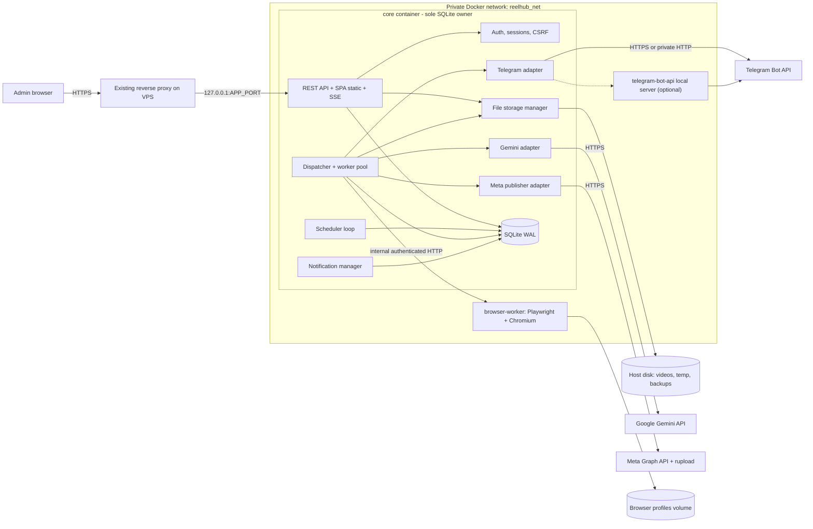
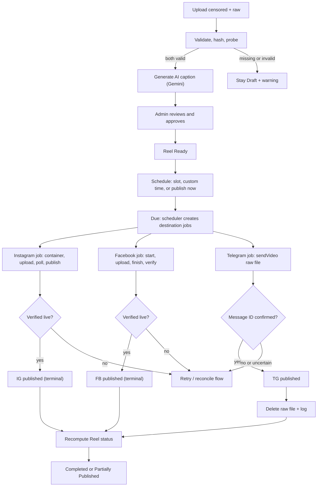
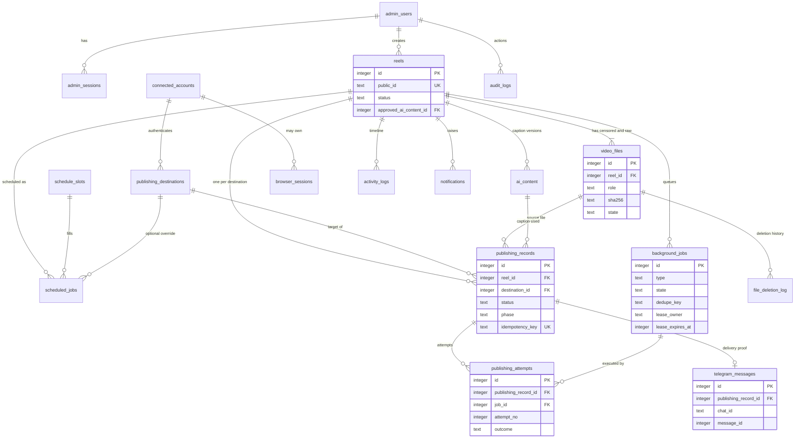
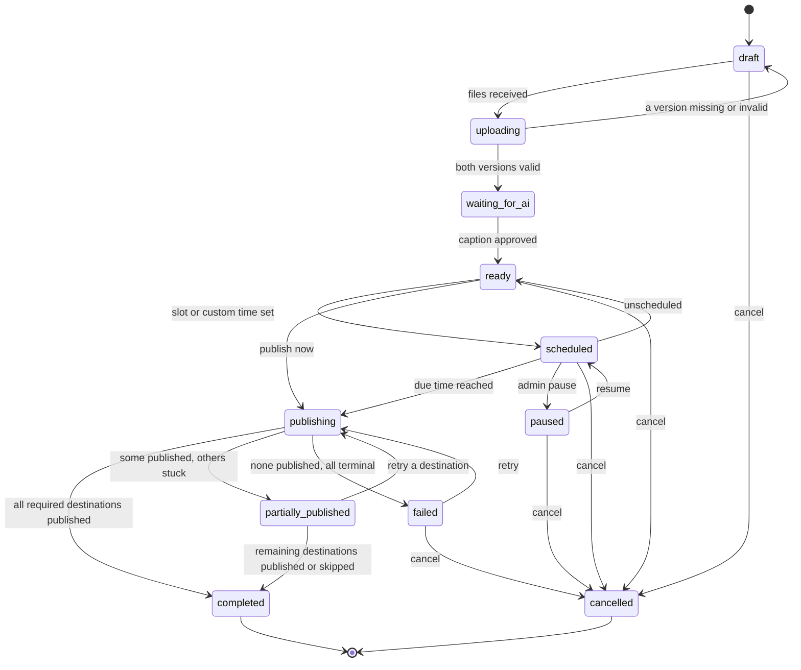
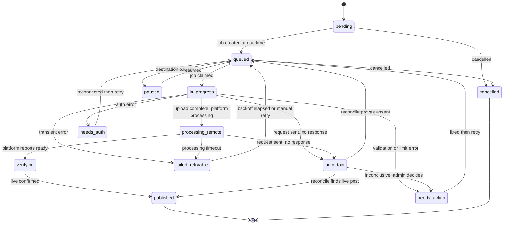
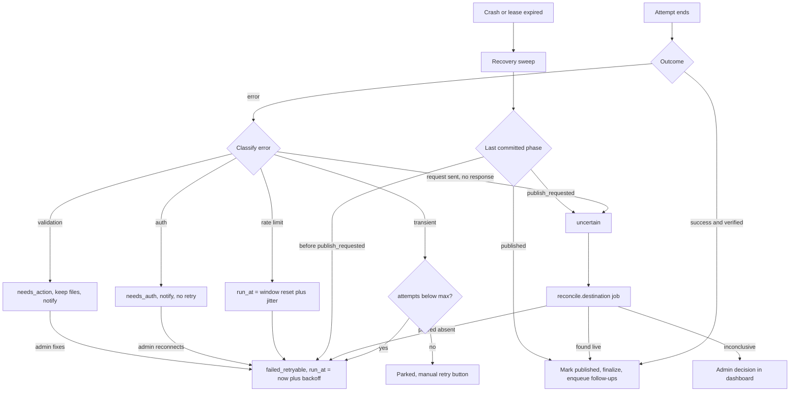

# Product Requirements Document

## Self-Hosted Reel Publishing & Chrome Automation Platform (working name: ReelHub)

**Prepared for:** Babu  |  **Document version:** 1.0 (MVP baseline)  |  **Research date:** 9 November 2026  |  **Default timezone:** Asia/Kolkata (IST)

**How to read this document.** Every requirement carries an ID (FR-, NFR-, SEC-) and a priority: **P0** = mandatory for MVP, **P1** = important, shortly after MVP, **P2** = future. Where official documentation could not be fully confirmed during research, the item is flagged as a **Verification Item (VI-n)** in Section 32 rather than guessed. No source code is included, by design.

---

## 1. Executive Summary

ReelHub is a private, single-administrator web application running on your existing Ubuntu VPS. For each short video you upload **two versions** — a *censored* version and a *raw* version — and ReelHub then:

1. Binds both files to one **Reel** record (by internal ID, never by filename).
2. Generates a caption and **exactly two hashtags** with the Gemini API, from the filename.
3. Lets you review/edit the caption, then schedules the Reel into configurable time slots (default IST).
4. Publishes the **censored** video to an **Instagram** professional account and a **Facebook Page** (as Reels) using Meta's official Graph API.
5. Publishes the **raw** video to a **Telegram channel** through a Telegram bot.
6. Verifies Telegram delivery, and only then **securely deletes the raw file** from the VPS.
7. Keeps a permanent publishing history in SQLite, independent of whether files still exist.

**Key architectural decisions (summary)**

| Decision | Choice | Why |
| --- | --- | --- |
| Database | SQLite (WAL) only; also the durable job queue and scheduler store | Mandated; fits single-VPS, single-admin load |
| Meta publishing | Official Graph API (resumable upload from local disk) | Supported, auditable, no public video URLs needed |
| Chromium/Playwright | Isolated, resource-capped, on-demand worker; **infrastructure is P0, UI-publishing fallback is P1 and off by default** | Meta provides official Reels APIs; UI automation of Instagram/Facebook carries account-restriction and ToS risk |
| Telegram | Bot API `sendVideo`; optional local Bot API server for files above 50 MB | Cloud Bot API caps uploads at 50 MB |
| Concurrency | One process owns the DB writes; small, bounded worker pool | SQLite allows one writer at a time |
| Deployment | Docker Compose project with its own name, network, ports, bind-mounted data, CPU/RAM limits | Must not disturb existing production services |

**Honest constraints you should know up front** (details in Sections 10, 12, 21, 32):

- Meta has **no native scheduling for Reels**; ReelHub holds the schedule and publishes at the due time.
- Instagram API publishing needs an **Instagram professional account** (not a personal one) connected to a Facebook Page, plus a Meta developer app. Because you only publish to accounts you own, **Standard Access** (app-role users) should be sufficient and full App Review may not be required — see VI-1.
- The Telegram Bot API (cloud) refuses uploads above **50 MB**; larger raw files require a self-hosted Bot API server container (supported by Telegram, up to 2000 MB).
- Neither Meta's Reels endpoints nor Telegram offer a request idempotency key, so duplicate prevention is built into ReelHub's own state machine and reconciliation logic (Section 19).

---

## 2. Product Vision and Objectives

**Vision:** Upload once, review once, and let a reliable machine publish everywhere on schedule — without ever double-posting, losing a raw file early, or harming other apps on the VPS.

**Objectives (measurable)**

| # | Objective | Target |
| --- | --- | --- |
| O1 | Time from upload to scheduled | ≤ 2 minutes of admin effort per Reel (excluding upload transfer) |
| O2 | Scheduled publish accuracy | Job starts within 60 s of slot time (P95) while the service is up |
| O3 | Duplicate posts | 0 duplicate IG/FB/Telegram posts caused by retries or restarts |
| O4 | Premature raw deletion | 0 occurrences; raw deleted only after verified Telegram delivery |
| O5 | Coexistence | Core idle footprint ≤ 512 MB RAM; browser worker hard-capped; no impact on other containers |
| O6 | Recoverability | Full restore from backup in ≤ 30 minutes |

---

## 3. Goals and Non-Goals

**Goals (MVP):** two-version Reel management; Gemini captions with exactly two hashtags; slot-based scheduling; official-API publishing to one Instagram account and one Facebook Page; Telegram raw publishing with verified-delivery deletion; per-destination independent state; durable SQLite queue; admin dashboard; backup/restore; Docker deployment safe for a shared VPS; extensible module boundaries.

**Non-Goals (MVP):**

- Multi-user/multi-tenant SaaS, public registration, billing.
- PostgreSQL, MySQL, MongoDB, or mandatory Redis.
- Video editing, censoring, or transcoding (files arrive already prepared; probing only).
- Analytics/insights, comment management, DMs.
- TikTok/YouTube/X publishing (extension points only).
- Bypassing CAPTCHA, 2FA, rate limits, or any platform security control — ever.
- Guaranteeing reach or virality of hashtags.
- Inventing the future features you mentioned; the architecture only leaves room for them (Section 28).

---

## 4. Target User and Usage Scenarios

**Primary (only) user:** the administrator (you). Technical level: non-developer who delegates implementation to an AI coding agent; therefore the UI must be self-explanatory and every failure must show a plain-language reason and a one-click next action.

**Scenarios**

- **S1 – Daily batch:** upload 5–10 pairs in the morning, review captions, click "Auto-schedule"; the system fills the next free slots.
- **S2 – Single urgent post:** upload one pair, click "Publish now".
- **S3 – Partial failure:** Facebook fails (expired Page token); Instagram and Telegram succeeded. You reconnect Facebook and retry only Facebook.
- **S4 – VPS reboot:** power cycle at 17:55; a 18:00 slot job runs after boot per the missed-schedule policy.
- **S5 – Raw file hygiene:** every raw file disappears after Telegram confirms delivery, and the dashboard proves it with a deletion log.

---

## 5. Core User Journeys

| Journey | Steps | Success state |
| --- | --- | --- |
| J1 Upload | Drag two files → validation + hashing → Reel created in *Draft* → both versions green → *Waiting for AI* | Reel *Ready* after caption approved |
| J2 Caption review | AI result appears → edit/regenerate → Approve | Caption locked and versioned |
| J3 Schedule | Pick slot / custom time / auto-assign → confirm | Reel *Scheduled*, `scheduled_jobs` row created |
| J4 Publish | Scheduler enqueues one job per enabled destination → workers publish → verify → Telegram deletion job | Reel *Completed* (or *Partially Published*) |
| J5 Recover | Failed destination shows reason → fix (reconnect / wait / edit) → Retry destination | Only that destination re-runs |
| J6 Maintain | Settings: slots, retention, backups, pause/resume | Changes audited |

---

## 6. Functional Requirements

| ID | Requirement | Pri |
| --- | --- | --- |
| FR-001 | A Reel owns exactly one *censored* and one *raw* video file, linked by internal Reel ID | P0 |
| FR-002 | Upload validation: extension allow-list, magic-byte/MIME check, ffprobe metadata (codec, duration, resolution, fps), size limit | P0 |
| FR-003 | Duplicate detection via SHA-256 and filename-stem comparison; same-name-different-content warning | P0 |
| FR-004 | Ready gate: a Reel cannot become *Ready* until both versions are validated and a caption is approved | P0 |
| FR-005 | Replace a video before publishing; blocked while a job uses the file | P0 |
| FR-006 | Gemini generates caption + exactly two hashtags as validated structured JSON | P0 |
| FR-007 | Caption edit, regenerate, version history; no regeneration during publish retries | P0 |
| FR-008 | Configurable slots: add/edit/delete/enable/disable; default timezone Asia/Kolkata | P0 |
| FR-009 | Auto-assign queued Reels to next free slots; conflict prevention | P0 |
| FR-010 | Manual schedule and reschedule (per Reel, per destination) with custom date/time | P0 |
| FR-011 | Global pause/resume and per-destination pause/resume | P0 |
| FR-012 | Missed-schedule recovery after downtime per configurable policy | P0 |
| FR-013 | Publish censored video as Instagram Reel via Graph API, store media ID and permalink | P0 |
| FR-014 | Publish censored video as Facebook Page Reel via Graph API, store video ID and URL | P0 |
| FR-015 | Publish raw video to Telegram channel via bot; store message ID and metadata | P0 |
| FR-016 | Independent per-destination status; Reel aggregate derived from destinations | P0 |
| FR-017 | Retrying one destination never re-executes another destination's publish | P0 |
| FR-018 | Delete raw file only after verified Telegram delivery; log every deletion | P0 |
| FR-019 | Configurable retention for censored files and completed Reel records (default: keep) | P1 |
| FR-020 | Dashboard overview widgets (counts, next job, storage, service status) | P0 |
| FR-021 | Reel Manager with all listed actions (view, edit caption, regenerate, replace, publish now, reschedule, retry, pause, cancel, delete) | P0 |
| FR-022 | Publishing history with attempts, IDs, URLs, errors, retries | P0 |
| FR-023 | Calendar views (day/week/month), drag-to-reschedule | P1 |
| FR-024 | Settings pages with write-only secret fields | P0 |
| FR-025 | In-dashboard notifications and activity log | P0 |
| FR-026 | Isolated Chromium/Playwright worker infrastructure: on-demand launch, persistent profile, screenshots, crash detection, limits | P0 |
| FR-027 | Browser-based publishing fallback adapter (feature-flagged, default OFF, human-in-the-loop for challenges) | P1 |
| FR-028 | Automated SQLite backups, integrity checks, documented restore | P0 |
| FR-029 | Meta account connection (OAuth), token health checks and refresh, re-auth prompts | P0 |
| FR-030 | "Publish now" for a Reel or a single destination | P0 |
| FR-031 | Pause, cancel, and reschedule jobs safely, including in-flight cancellation semantics | P0 |
| FR-032 | Telegram admin notifications (separate bot/chat from publishing) | P2 |
| NFR-001 | All schedules and job state survive process, container, and VPS restarts | P0 |
| NFR-002 | A job can be executed by at most one worker at a time | P0 |
| NFR-003 | Per-container CPU/RAM limits; Chromium cannot starve other services | P0 |
| NFR-004 | Dashboard P95 page load < 1 s on typical data volumes (≤ 10,000 Reels); scheduler lag ≤ 30 s | P0 |
| NFR-005 | Active SQLite file on local persistent disk, never on network FS or ephemeral layer | P0 |
| NFR-006 | Zero modification of existing Compose projects, volumes, containers, or configs | P0 |
| NFR-007 | Structured logs with rotation; health endpoints for every service | P0 |
| NFR-008 | Configurable max upload size (default 500 MB per file) | P0 |
| SEC-001 | Passwords hashed with Argon2id; no plaintext anywhere | P0 |
| SEC-002 | Secure cookie sessions, CSRF protection, session expiry/revocation | P0 |
| SEC-003 | Login and API rate limiting with lockout backoff | P0 |
| SEC-004 | Secrets encrypted at rest (AES-256-GCM); write-only in UI; never logged | P0 |
| SEC-005 | Path validation: all file operations confined to the storage root | P0 |
| SEC-006 | No public URLs for any video; previews only via authenticated streaming | P0 |
| SEC-007 | Append-only audit log of administrative and destructive actions | P0 |
| SEC-008 | Upload hardening (size, type, filename sanitization, temp-then-move) | P0 |
| SEC-009 | Authenticated, network-isolated internal API between core and browser worker | P0 |
| SEC-010 | Optional TOTP 2FA for the admin login | P1 |

**Additional requirements defined elsewhere:** **SEC-011 (P0)** — users see only generic error messages with a request ID; stack traces and provider payloads stay in redacted logs. **NFR-009 to NFR-015** are defined in Section 25 (NFR-014, restore time, is P0; the others are P1 quality targets). Acceptance criteria for all P0 items are in Section 29.

---

## 7. Detailed Video Upload and Management Workflow

### 7.1 Upload sequence

1. Admin opens **Upload Manager** and drops one or more pairs. Each pair has two slots: *Censored (Instagram/Facebook)* and *Raw (Telegram)*. Bulk mode accepts many files and auto-pairs them by normalized filename stem; unpaired files stay as incomplete Drafts and are flagged.
2. The browser streams each file to the API (multipart streaming, no in-memory buffering) with a progress bar. Files land in `temp/` under a random UUID name.
3. Server computes SHA-256 while streaming, then runs **ffprobe** to extract container, video/audio codec, duration, resolution, frame rate, and bitrate.
4. Validation rules run (7.2). On success the file is atomically moved into `videos/censored/` or `videos/raw/` as `<uuid>.<ext>`; the original filename is stored only as metadata.
5. A `reels` row and two `video_files` rows are created/updated inside one transaction. The Reel remains **Draft** until both versions are *validated*.
6. When both are validated, the Reel moves to **Waiting for AI** and a `ai.generate` job is queued.

### 7.2 Validation rules

| Check | Rule | On failure |
| --- | --- | --- |
| Extension | `.mp4`, `.mov` (configurable) | Reject file, keep Reel Draft |
| MIME / magic bytes | Must match a video container signature; extension alone is not trusted | Reject |
| Size | ≤ configured limit (default 500 MB each); also warn if raw > Telegram limit of the chosen mode (50 MB cloud / 2000 MB local server) | Reject or warn |
| Metadata | Playable video stream present; duration > 0; Instagram-oriented warnings: duration outside 3 s–15 min, resolution/fps/codec outside Meta's documented Reel specs (VI-3) | Warn on censored; block only if unplayable |
| Facebook minimum | Resolution below 540p is rejected by Meta at processing time | Block censored file with clear message |
| Hash | SHA-256 computed; stored | — |
| Disk space | Free space ≥ 2× incoming size + safety reserve before accepting | Reject with "disk low" notification |

### 7.3 Duplicate and mismatch handling

- **Exact duplicate** (same SHA-256 in the same role): block with link to the existing Reel; admin may override.
- **Same filename, different contents:** allowed (the example in your brief has identical names for both versions), but if two *Reels* share a filename stem with different hashes, show a warning.
- **Censored hash equals raw hash:** warn "both versions are identical — is the raw file really raw?"; allow override.
- **Duration mismatch** between versions beyond a configurable tolerance (default 25%): warn.

### 7.4 Replacement and locking

- Replacement is allowed while the Reel is Draft/Ready/Scheduled; the old file is moved to a quarantine state and deleted by the retention job, never inline.
- Each `video_files` row has a **lease/in-use marker** set by any job that opens the file. Replacement, deletion, and retention cleanup check it inside a transaction; if in use, the action is refused with "file is being used by a publishing job".
- Replacing a file of a Scheduled Reel re-runs validation and re-opens the caption approval only if the filename changed.

### 7.5 Storage layout (refined from your sketch)

All paths live under one storage root, mounted from the host (default `/srv/reelhub/`):

| Directory | Purpose |
| --- | --- |
| `db/` | `reelhub.sqlite` + WAL/SHM files (local disk only) |
| `videos/censored/` | Censored files, named by UUID |
| `videos/raw/` | Raw files, named by UUID (deleted after Telegram success) |
| `videos/quarantine/` | Replaced/cancelled files awaiting retention cleanup |
| `temp/` | In-flight uploads; purged on startup if older than 24 h |
| `browser-profiles/` | Chromium persistent profiles (browser worker only) |
| `logs/` | Application logs and failure screenshots |
| `backups/` | Encrypted SQLite backups |

---

## 8. Gemini AI Integration

**Input:** the original filename only (primary), e.g. `abandoned_hospital_ghost_sighting_001.mp4`. **Pre-processing (deterministic, before calling Gemini):** remove extension; replace `_` and `-` with spaces; strip trailing numeric suffixes/versions (`001`, `v2`, `final`); collapse whitespace; reject if the cleaned text is empty or under 3 characters (then ask the admin to type a caption).

**Output contract (structured JSON):** `title` (string, 20–150 chars), `hashtags` (array of exactly 2 strings). The request uses Gemini's structured-output mode (JSON MIME type plus a response schema), per Google's documentation; the model name is a setting, not hard-coded, because model names change (VI-4).

**Validation after every response (never trust the model):**

- Parses as JSON; schema matches; no extra fields required.
- Exactly two hashtags; each matches `#` + letters/digits/underscore, no spaces, 3–30 chars, unique, no banned/blocked terms list (configurable).
- Caption has no URLs/mentions/phone numbers and no hashtags inside the title.
- Title length limits per platform respected (Instagram caption limit leaves room for hashtags).
- On failure: one automatic retry with a stricter prompt; then mark `ai_status=failed`, Reel stays *Waiting for AI* with a "write manually" option.

**Operational rules**

| Topic | Rule |
| --- | --- |
| Truncation risk | Reasoning-capable Gemini models can spend output tokens on internal thinking and truncate JSON; set a generous output-token ceiling and a small thinking budget, and treat truncated JSON as malformed (observed community-reported issue) |
| Rate limits / outages | Exponential backoff on 429/5xx; fallback to the next configured model; after max attempts show "AI unavailable — enter caption manually" |
| Retry safety | Publishing jobs only read the **approved** `ai_content` row; they never call Gemini (FR-007) |
| Versioning | Every generation, regeneration, and manual edit is a new `ai_content` version; exactly one is `approved` |
| Platform captions | `ai_content` has a nullable `platform` column so per-platform captions can be added later without schema change |
| Secrets | API key only in backend environment/secret file; never sent to the browser; redacted from logs |
| Expectation | Hashtags are suggestions; no promise of reach |

---

## 9. Scheduling and Time-Slot System

### 9.1 Slots

`schedule_slots` hold a local time-of-day, optional weekday mask, timezone (default Asia/Kolkata), `enabled`, and `sort_order`. Example defaults: 10:00, 14:00, 18:00, 21:00 — all editable. Deleting a slot never cancels already-scheduled jobs; those keep their absolute timestamp.

### 9.2 Time handling

All instants are stored as **UTC epoch milliseconds**; the slot's timezone is only used to convert local slot times to UTC when jobs are created and to render the UI. This makes scheduling immune to display-timezone changes.

### 9.3 Assignment rules

- **Auto-assign:** takes Reels in *Ready* state ordered by priority then creation time, and assigns each to the earliest enabled slot instant that is in the future and not occupied (one Reel per slot instant by default; capacity per slot configurable).
- **Manual:** choose a slot or any custom date/time; conflicts (same destination within a configurable minimum gap, default 10 minutes) are blocked or confirmed.
- **Per-destination override:** a Reel's destinations normally share one time; the admin may give a destination its own time (creates separate `scheduled_jobs`).
- **Platform ceilings:** before enqueueing, the scheduler checks configurable daily caps (Facebook Reels API: 30 API-published Reels per rolling 24 h per the official Reels Publishing doc; Instagram: reported 100 API posts/24 h, with a live check available through the `content_publishing_limit` endpoint). Over-cap jobs are deferred, not failed.

### 9.4 Execution and pause semantics

- A single **scheduler loop** (every 15 s) promotes due `scheduled_jobs` into `background_jobs` (one per enabled destination) inside one transaction using unique dedupe keys, so a repeated tick cannot create duplicates.
- **Global pause** stops promotion and prevents new job claims; in-flight jobs finish their current external call. **Destination pause** does the same for one destination. Paused jobs keep their due time.
- Nothing depends on an open browser tab.

### 9.5 Missed-schedule recovery

On startup and every tick, due jobs older than their time are handled by policy (setting `missed_policy`):

| Lateness | Default action |
| --- | --- |
| ≤ 2 hours | Run immediately (in order) |
| > 2 hours | Mark `missed`, notify, and auto-move to the next free slot (or hold for manual decision if policy = *ask*) |

Catch-up bursts are throttled (default 1 publish per destination per 2 minutes) to avoid rate-limit trouble after long downtime.

---

## 10. Instagram and Facebook Publishing

*Research basis: Meta developer documentation (Instagram Platform Content Publishing, IG User Media reference, Facebook Reels Publishing API), read 9 November 2026. Meta changes API versions, limits, and permissions frequently; every number below is a configurable setting, and items marked VI must be re-checked against the live docs before the Meta app is configured.*

### 10.1 Integration path (decision)

Meta offers two Instagram publishing paths. ReelHub uses **Facebook Login for Business** (Path A) because Facebook Page publishing is also required, so one Meta app and one login cover both.

|  | **Path A: Facebook Login for Business (chosen)** | **Path B: Instagram API with Instagram Login** |
| --- | --- | --- |
| Hosts | `graph.facebook.com` (+ `rupload.facebook.com` for video bytes) | `graph.instagram.com` |
| Needs a Facebook Page linked to the IG account | Yes | No |
| Instagram permissions | `instagram_basic`, `instagram_content_publish`, `pages_show_list`, `pages_read_engagement` | `instagram_business_basic`, `instagram_business_content_publish` |
| Facebook Page publishing | Same login | Separate Facebook integration needed |
| Use in ReelHub | Default for IG + FB | Documented fallback if Page linking is impossible (P2) |

### 10.2 Eligibility prerequisites (your side, before development)

| Requirement | Detail |
| --- | --- |
| Instagram account type | **Professional** (Business or Creator). Personal accounts cannot publish via API. Secondary sources disagree on whether Creator accounts can publish Reels; Meta's docs state Stories are restricted to Business accounts. Use a **Business** account to be safe (VI-2). |
| Facebook Page | You must hold a role on the Page that permits publishing; the Instagram account must be linked to that Page for Path A |
| Meta developer app | Create an app, add Instagram and Facebook Login for Business products, add yourself (and the Page/IG owner) as app-role users |
| Access level | **Standard Access** covers assets you own/manage, which matches a private single-admin tool; **Advanced Access** (App Review + Business Verification) is only required to serve accounts owned by other people. Meta also states an app must be connected to a Business Verified business before the app is switched to Live mode, so staying in Development mode with role users is the lowest-friction route (VI-1). |
| Video source | Resumable upload from local disk (no public URL required) |

### 10.3 Instagram Reel publishing flow (Path A)

Two-step container model with a resumable upload, per Meta's documentation:

1. **Create container:** `POST /{ig-user-id}/media` with `media_type=REELS`, `upload_type=resumable`, `caption` (and optional `share_to_feed`, `cover_url`). Response: container ID and an upload URI.
2. **Upload bytes:** `POST https://rupload.facebook.com/ig-api-upload/{version}/{container-id}` with the file body (host and auth scheme differ from normal Graph calls; the token is sent with the `OAuth` scheme per docs). Resumable: on interruption, resume from the byte offset instead of restarting.
3. **Poll container status:** `GET /{container-id}?fields=status_code` until it reports completion (or an error/expiry state). ReelHub polls with backoff up to a configurable maximum (default 10 minutes).
4. **Publish:** `POST /{ig-user-id}/media_publish` with the container ID as `creation_id`. Response: media ID.
5. **Capture result:** `GET /{media-id}?fields=permalink` and save media ID + permalink.

Note: since July 2023 Meta publishes single feed videos as Reels; stickers (link, poll, location) cannot be published via API; user mentions without stickers can.

### 10.4 Facebook Page Reel publishing flow

Three phases on `POST /{page-id}/video_reels` using a **Page access token**:

1. **Start:** `upload_phase=start` → returns `video_id` and an `upload_url` on `rupload.facebook.com`.
2. **Upload:** `POST` the file to the upload URL (header `Authorization: OAuth <page token>`, plus offset/file-size information per docs). Interrupted uploads are resumed using the `bytes_transfered` value from the status endpoint.
3. **Finish/Publish:** `upload_phase=finish`, `video_id`, `video_state=PUBLISHED`, `description` (caption + hashtags), optional `title`.
4. **Verify:** `GET /{video-id}?fields=status` and inspect `uploading_phase`, `processing_phase`, `publishing_phase`; mark success only when publishing is complete. Meta documents that the minimum resolution is 540p (processing error otherwise) and that Reels can only be published to Pages, not profiles.

Meta does not support `scheduled_publish_time` for Reels, so scheduling is entirely ReelHub's responsibility.

### 10.5 Checkpointing, verification, and duplicate prevention

Neither flow has an idempotency key. ReelHub therefore **persists a checkpoint after every external step** (in `publishing_records` and `publishing_attempts`) and decides retries from the checkpoint, never from scratch:

| Step completed | Persisted | If the process dies here, on recovery |
| --- | --- | --- |
| IG container created | `remote_container_id`, upload URI | Resume upload to the same container; do not create another |
| IG upload finished | `upload_complete_at` | Poll status; do not re-upload |
| IG `media_publish` **sent, no response** | `publish_requested_at` | State = *uncertain*: query container status and recent IG media; if found, mark published; if not found after the reconcile window, allow retry |
| IG media ID received | `remote_post_id`, permalink | Mark *published*; nothing else may run |
| FB session started | `remote_video_id` | Resume upload for the same `video_id` |
| FB `finish` **sent, no response** | `publish_requested_at` | *Uncertain*: read `status`; if `publishing_phase` complete → published, else retry `finish` |
| FB published | `remote_post_id`, URL | Mark *published* |

A destination in state *published* is **terminal**: the job claimer refuses to create new work for it (FR-017). "Verified" for Meta destinations = media/video ID returned **and** a status read confirming it is live.

### 10.6 Tokens and account health

- OAuth connection happens in the admin's own browser via the standard Meta redirect flow (no automation involved, no credentials entered into ReelHub).
- Store the long-lived user token, Page token, IG user ID, Page ID, scopes granted, and expiry **encrypted** (SEC-004). Page tokens derived from a long-lived user token are documented by Meta as long-lived; the user token itself expires and must be refreshed or re-authorized (VI-5).
- A daily `token.refresh` job and a pre-publish `GET /me?fields=id` check detect expiry, revoked permissions, or password-change invalidation. On failure: destination → *Needs authentication*, notification raised, **no retry loop**.
- Meta may require an interactive re-login/2FA; ReelHub never automates or bypasses it.

### 10.7 Platform limits (configurable, shown in Settings)

| Limit | Value found | Source status |
| --- | --- | --- |
| Facebook Reels API posts | 30 per rolling 24 h per Page | Official Reels Publishing doc |
| Instagram API-published posts | 100 per rolling 24 h per account (check live with `content_publishing_limit`) | Third-party summaries of Meta docs; verify (VI-3) |
| Instagram Reel file | MP4/MOV, H.264/HEVC + AAC, 3 s–15 min, ≤ 300 MB, 23–60 fps, 9:16 recommended | Secondary summary of Meta's media reference (VI-3) |
| Facebook Reel minimum resolution | 540p | Official Reels Publishing doc |
| Graph API version | Pin one version (docs currently show v25.0–v26.0), upgrade deliberately | Official |

Because the default upload limit (500 MB) exceeds Instagram's 300 MB Reel limit, the censored file gets a **platform pre-flight check**: oversize/overlong files are flagged *Not publishable to Instagram* before scheduling.

### 10.8 Error classification

| Class | Examples | Behavior |
| --- | --- | --- |
| Auth | expired/revoked token, missing permission | No retry; *Needs authentication*; notify |
| Rate limit | publishing limit reached | Defer to window reset (jittered), retry automatically |
| Validation | bad codec, too short/long, resolution | Terminal for the destination; *Needs action*; keep file |
| Transient | network, 5xx, timeouts | Exponential backoff, max attempts, then *Failed (retryable manually)* |
| Uncertain | timeout after publish request | Reconcile first, then decide (10.5) |

---

## 11. Chrome Automation Architecture

### 11.1 Decision: API-first, browser as isolated capability

Meta offers official Reels publishing APIs for both Instagram and Facebook, so ReelHub publishes through them. Driving the Instagram/Facebook web UI with a bot is **not** the default because it is fragile (UI changes), can trigger platform security checks and account restrictions, and may conflict with the platforms' terms of use. Playwright with Chromium is nonetheless built as a first-class, isolated worker so that browser workflows exist when needed.

| Capability | Priority | Notes |
| --- | --- | --- |
| Isolated browser worker container, on-demand Chromium, persistent profile, screenshots, diagnostics, crash recovery, resource limits | **P0** | Delivered and tested with a neutral self-test page, not with a social platform |
| Session health tracking in `browser_sessions` (created, last used, last verified, status) | **P0** | Supports whichever adapter uses it |
| Interactive manual login mode (headed Chromium streamed to the admin through the authenticated dashboard) | P1 | The admin completes any 2FA/CAPTCHA personally |
| Browser publishing adapter for destinations the API cannot reach | P1, **default OFF**, per-destination feature flag with an explicit risk acknowledgement | Human-in-the-loop on any challenge |
| Other browser workflows (future features) | P2 | Plug into the same adapter interface |

### 11.2 Components and boundaries

- **Browser worker container** (separate image based on Microsoft's official Playwright image, pinned to an exact version on Ubuntu 24.04 "noble"). Runs Node/Playwright with Chromium only.
- **No database access.** The worker never opens SQLite. It talks to the core service over an authenticated internal HTTP API on the private Compose network: core hands it a *browser task* (type, parameters, file reference by ID, timeout); the worker returns progress heartbeats and a result. This keeps SQLite a single-process-writer database (Section 17).
- **Files:** the worker receives read-only access to the required video via a read-only bind mount of the censored directory (raw directory is **not** mounted), referenced by file ID, never by user-supplied path.
- **Persistent context:** one Chromium user-data directory per account under `browser-profiles/<account-id>/`, stored only on the worker's volume, file-permissioned to the worker user.

### 11.3 Lifecycle and concurrency

- **Concurrency = 1** browser task at a time (default). Chromium launches when a task starts and closes after a configurable idle period (default 120 s) so RAM returns to the host.
- Each task has a hard wall-clock timeout; on timeout the worker kills the Chromium process tree and reports *browser\_timeout*.
- A watchdog in the worker detects Chromium crash/disconnect, captures what diagnostics it can, and reports *browser\_crashed*; core retries per policy, with a cap on consecutive crashes after which browser tasks are auto-paused and an administrator notification is raised.
- On failure the worker saves a screenshot, page URL, console errors, and a trimmed network log (no tokens, cookies, or form values) into `logs/` and links them to the attempt.

### 11.4 Session security

- Profile directories contain live cookies: treat as secrets (restricted permissions, excluded from unencrypted backups, never served through any web endpoint).
- Session expiry is detected by task-level checks (login wall, redirect to login); the destination becomes *Needs authentication*; there is no auto-login attempt, no stored passwords, and no credential replay.
- "Delete session" in Settings wipes the profile directory and the `browser_sessions` row.

### 11.5 Resource management on a shared VPS

| Control | Default | Why |
| --- | --- | --- |
| Container memory limit | 1.5 GB (hard) | Chromium is the largest consumer; OOM kills only this container |
| CPU limit | 1.0 core, low priority | Protects other production services |
| Shared memory | `shm_size` 1 GB (preferred) rather than sharing the host IPC namespace | Playwright docs recommend `--ipc=host` or enough shared memory to avoid Chromium crashes; a dedicated `shm_size` keeps isolation |
| `init` process | enabled | Avoids zombie Chromium processes (per Playwright docs) |
| PID limit | set | Prevents runaway process trees |
| OOM priority | raised for this container | Kernel kills it first under memory pressure |
| Start policy | Compose profile, started only if browser features are enabled | No idle cost when unused |
| Sandbox | Run as non-root `pwuser` with Chromium sandbox enabled using the seccomp profile Playwright documents for user-namespace cloning | Defense in depth |

### 11.6 Absolute prohibitions

ReelHub **never**: solves or bypasses CAPTCHAs; defeats or automates 2FA/OTP; uses stealth/anti-detection plugins or fingerprint spoofing; rotates proxies to evade limits; scrapes or collects third-party user data; or continues retrying after a platform challenge or block. Any such signal pauses the destination and asks the admin.

---

## 12. Telegram Publishing

### 12.1 Setup

Settings accept: **bot token** (write-only), **channel identifier** (numeric ID or `@username`), optional **local Bot API server URL**. "Validate" runs three checks: the token is valid (`getMe`), the channel is reachable (`getChat`), and the bot is an **administrator with permission to post messages** (`getChatMember` for the bot). Failure shows which check failed.

### 12.2 Upload modes and size limits

| Mode | Max upload | Notes |
| --- | --- | --- |
| Cloud Bot API (`api.telegram.org`) | **50 MB** per file via multipart | Default |
| Self-hosted Telegram Bot API server (official open-source server) | up to **2000 MB** | Optional extra container; needs a Telegram `api_id`/`api_hash`; serves plain HTTP on the private network only |

The file size is checked at upload time against the active mode. A raw file larger than the active limit is not uploaded: the destination becomes *Needs action* with the message "File exceeds Telegram limit — enable the local Bot API server". URL-based sending is not used (it requires a public URL and has a lower limit, which also conflicts with SEC-006).

### 12.3 Send flow

1. Pre-checks: file exists, hash matches stored value, bot validated within the last 24 h.
2. `sendVideo` multipart upload of the raw file with the approved caption (Telegram's caption limit is 1024 characters; the app truncates safely and warns, VI-6), streaming flag enabled, original filename never exposed.
3. On HTTP success, parse the response: require `ok: true`, a message ID, the channel/chat ID, and a `video` object (capturing `file_id`, `file_unique_id`, size, duration).
4. In **one transaction**: insert `telegram_messages`, set destination to *published*, write the attempt as *succeeded*, and enqueue `file.delete_raw`.

### 12.4 Uncertain delivery (timeout / connection loss after sending)

Telegram's Bot API offers no idempotency key, so a blind retry can post twice. ReelHub:

1. Marks the attempt *uncertain* and the destination *Delivery uncertain*; **the raw file is retained**.
2. Enables reconciliation through `channel_post` updates the bot receives as a channel admin (the bot's update subscription includes channel posts): it searches recent updates for a message from the target channel matching video size, duration, and caption within the attempt's time window.
3. Match found → record message ID, treat as delivered (then the normal deletion path). No match after the reconcile window (default 15 minutes) → offer automatic retry or manual decision.
4. If reconciliation is inconclusive (e.g., pending updates already consumed), the dashboard asks the admin to choose: *I see it in the channel → paste message link* or *Not delivered → retry*. Never retried silently.

### 12.5 Rate limiting and retries

Telegram throttles bots per chat; ReelHub sends at most one Telegram upload at a time (default) and honours `retry_after` from 429 responses exactly. Network and 5xx errors retry with backoff only if the attempt did not reach the *request sent* checkpoint; otherwise follow 12.4.

---

## 13. File Deletion and Retention

### 13.1 Raw-file deletion: hard preconditions (all must hold, checked inside one transaction)

1. The `telegram_messages` row exists with message ID and success timestamp for **every enabled Telegram destination** of the Reel (future multi-channel safe).
2. The destination state is *published* (not *uncertain*, not *failed*).
3. No active job lease references the file (`video_files.in_use_by_job_id` is null and no `background_jobs` row in `leased/running` references it).
4. The stored path resolves (after symlink resolution) **inside** `videos/raw/` and the file name equals the stored UUID name.
5. Optional re-verification: file size equals recorded size (guards against deleting a different file).

### 13.2 Procedure

`file.delete_raw` job → acquire file lock → re-check preconditions → unlink the file → fsync the directory → in one transaction set `video_files.state='deleted'`, `deleted_at`, and insert a `file_deletion_log` row (path hash, size, hash, reason, job, outcome). Failure (permission, I/O): row `state='deletion_failed'`, error recorded, notification raised, retry with backoff (max configurable), plus a manual "Retry cleanup" button. The Reel's publishing history is unaffected either way.

### 13.3 Never-delete rules

- Telegram failed, uncertain, or not yet attempted → retain.
- Any lease active → defer (re-queue after 5 min).
- Path validation fails → refuse, log a security event, alert the admin.
- The censored file is **never auto-deleted by default**.

### 13.4 Retention settings

| Setting | Default | Options |
| --- | --- | --- |
| Censored file retention | Keep forever | Keep N days after Reel completion; delete when disk < threshold (oldest first, completed Reels only) |
| Quarantined/replaced files | 7 days | 0–90 days |
| Completed Reel record retention | Keep forever | Archive/purge after N days (history rows are kept unless purge is explicitly chosen) |
| Orphan/temp cleanup | 24 h | 1–72 h |

Retention deletion uses the same safe-delete routine, the same logging, and never touches a Reel that is not *Completed*, *Cancelled*, or *Archived*.

---

## 14. Dashboard and UI/UX Requirements

**Design principles:** one clean admin app, light/dark, responsive (usable on a phone for quick checks), every status is a colored chip plus text (never color only), every failure shows *what happened → what is safe → what to click*, destructive actions require confirmation that names the consequence (e.g., "This raw file has not been delivered to Telegram yet").

| Page | Contents | Key interactions |
| --- | --- | --- |
| **Overview** (FR-020) | Cards: total, Draft, Ready, Pending, Scheduled, Completed, Partially Published, Failed jobs; per-platform status tiles (IG, FB, Telegram: connected/needs auth/paused, last success, today's count vs cap); next scheduled Reel countdown; recent activity feed; storage gauge (videos, DB, backups, free disk); service health (core, scheduler, workers, browser worker, Telegram local server) | Click any card to open a filtered Reel Manager |
| **Reel Manager** (FR-021) | Table/card toggle with columns: Reel ID, original filename, censored status, raw status, caption, IG / FB / Telegram chips, scheduled time (IST), overall status, created, actions | Filters, search, bulk select (schedule, pause, delete drafts); row actions: view, edit caption, regenerate AI, replace video, publish now, reschedule, retry destination, pause, cancel, delete |
| **Reel Detail** | Both video previews (authenticated streaming), file metadata, caption versions, per-destination timeline with attempts, error details, deletion log | Retry single destination; copy post URL |
| **Upload Manager** | Two-slot drop zones, bulk pairing table, progress bars, validation results, missing-version and duplicate warnings | Fix pairing, replace file, discard draft |
| **Calendar** (FR-023, P1) | Day/week/month; slots rendered as cells with availability; scheduled Reels as chips | Drag to reschedule; click empty slot to assign |
| **Publishing History** (FR-022) | Rows per attempt: Reel ID, filename, platform, attempt #, time, post/message ID, URL, status, error, retry lineage | Filter by platform/status/date; export CSV |
| **Notifications** | Unread list, severity, links to affected Reel | Mark read, mute type |
| **Settings** (FR-024) | Tabs: Gemini, Telegram, Meta accounts, Slots & timezone, Limits & storage paths, Retention, Browser automation, Workers & retries, Notifications, Security (password, sessions, optional 2FA), Backups | Secrets are write-only fields showing only a masked fingerprint (e.g., last 4 chars) after saving; "Test connection" buttons |

**Safeguards in the UI:** actions are disabled with a tooltip explaining why (e.g., "File in use by a publishing job"); "Publish now" shows exactly which destinations will run; global *Pause automation* is a persistent top-bar toggle.

---

## 15. System Architecture

### 15.1 Components

| Component | Runs in | Responsibility |
| --- | --- | --- |
| Frontend dashboard | Static SPA served by core | UI only; never calls Meta/Telegram/Gemini directly; no secrets |
| Backend API | core | REST + server-sent events for progress; validation; authorization |
| Authentication module | core | Login, sessions, CSRF, rate limiting, audit |
| File storage manager | core | Streaming uploads, hashing, safe moves, path validation, safe delete, disk monitoring |
| Gemini integration | core | Prompt building, structured-output call, response validation |
| Scheduling engine | core | Promotes due schedule entries into queue jobs; slot logic; missed-schedule policy |
| SQLite job queue + dispatcher | core | Atomic claim, leases, retries, recovery; bounded worker pool |
| Meta publishing integration | core (worker pool) | Instagram/Facebook Reel flows via Graph API |
| Telegram publishing integration | core (worker pool) | `sendVideo`, reconcile, verification |
| Playwright/Chromium worker | `browser-worker` container | Browser tasks on request from core; no DB access |
| Notification manager | core | Event → notification rows → dashboard (+ future channels) |
| Logging & monitoring | core + Docker | Structured logs, health endpoints, metrics endpoint (internal) |

**Rule:** the dashboard never performs publishing. It only creates intent (schedule/publish-now rows); workers execute.

### 15.2 System architecture diagram

### 15.3 Data flow (happy path)

1. Admin uploads two files → API streams them to `temp/`, hashes, probes, validates → FSM moves to final directories → transaction creates Reel + file rows → `ai.generate` job queued.
2. Dispatcher runs `ai.generate` → Gemini adapter → validated result stored as an `ai_content` version → Reel *Waiting for AI* → admin approves → *Ready*.
3. Admin schedules (or auto-assigns) → `scheduled_jobs` row.
4. At due time the scheduler, in one transaction, creates one `publishing_records` row per enabled destination (if absent) and one `background_jobs` row each, with unique dedupe keys.
5. Workers claim jobs atomically, perform the destination flow with checkpointing, and finalize results in short transactions.
6. Telegram success transaction enqueues `file.delete_raw`; deletion job removes the raw file and logs it.
7. Aggregate Reel status is recomputed from destination states; notifications and activity logs are written.

### 15.4 Reel publishing workflow diagram

---

## 16. Technology Stack

Selection principle: **fewest moving parts that satisfy the requirements on one shared VPS.** One language (TypeScript) across frontend, backend, and browser worker reduces what your AI developer must keep consistent.

| Area | Recommendation | Rationale / alternatives considered |
| --- | --- | --- |
| Language / runtime | TypeScript on Node.js (current LTS) | Playwright's first-class runtime is Node; streams handle large uploads without buffering; one language everywhere. Python/FastAPI is viable but splits the stack because the browser worker would stay Node |
| Backend framework | Fastify | Lightweight, schema-validated routes, good streaming/multipart support, low RAM. Express is older with less built-in validation; NestJS adds weight not needed for one admin |
| API structure | REST/JSON under `/api/v1`, plus one SSE stream for live status | Simple to test and to hand to an AI agent; no GraphQL/WebSocket complexity |
| Frontend | React + Vite + TypeScript, Tailwind CSS, a component kit (e.g., shadcn/ui), TanStack Query; calendar via a mature calendar component for P1 | Large ecosystem, easy for AI coding agents; compiled to static files served by core (no separate Node server in production) |
| SQLite driver | `better-sqlite3` | Synchronous, fastest Node driver, supports WAL, online backup API, and explicit `BEGIN IMMEDIATE`. Note: synchronous calls block the event loop, so every write transaction must stay short (Section 17) |
| Query layer / ORM | A typed query builder (Kysely) with hand-written SQL migrations | Full control of the claim/lease SQL; avoids heavy-ORM surprises with SQLite locking. Drizzle is an acceptable alternative |
| Scheduler | In-process loop (15 s tick) reading `scheduled_jobs` | Persistent state is in SQLite, so no cron dependency; a maintenance cron library is optional |
| Job queue | **Custom SQLite queue** (Section 19) | BullMQ and similar need Redis (forbidden for MVP); generic SQLite queue libraries are unaudited for our lease/idempotency semantics |
| Browser automation | Playwright (pinned exact version) + Chromium, in Microsoft's official Playwright image on Ubuntu 24.04 | Official image bundles browsers and system deps; avoids host contamination |
| Video metadata | `ffprobe` (FFmpeg package) inside core image | Reliable codec/duration/resolution detection; no transcoding in MVP |
| Upload handling | Streaming multipart (busboy via Fastify plugin) to `temp/`, then atomic rename | Constant memory; P1: resumable uploads with the tus protocol for flaky networks |
| Authentication | Argon2id hashing, server-side sessions in SQLite, HttpOnly Secure SameSite cookies, CSRF tokens, rate limiter; P1 TOTP | Simple, no external identity provider |
| Secrets at rest | AES-256-GCM using Node's crypto; master key from a Docker secret/file, never in the DB | No external vault needed for one admin |
| Validation | Zod (shared types between frontend and backend) | Single source of truth for request and AI-response validation |
| Logging | Pino JSON logs to stdout with redaction rules; Docker `json-file` rotation | Cheap, searchable, no log stack to run |
| Reverse proxy | Whatever already fronts your VPS (Nginx, Caddy, or Traefik); ReelHub only needs one new host entry to `127.0.0.1:<port>` | Avoids a second proxy fighting for ports 80/443. Requirements: raised request-body limit, long upload timeouts, SSE not buffered |
| Testing | Vitest (unit/integration), Playwright Test (end-to-end), k6 or similar for upload load tests | Same ecosystem as the app |

---

## 17. SQLite Database Architecture

### 17.1 Why SQLite fits, and where it does not

SQLite in WAL mode supports many concurrent readers with **one writer at a time**. ReelHub's write volume (tens of Reels/day, a few jobs per Reel, heartbeats every \~30 s) is tiny, so it fits comfortably. Honest limitations:

- Only one write transaction can be active; long writes block others (they wait, up to the busy timeout, then fail with *database is locked*).
- WAL requires shared memory between processes on the **same host** and a **local** filesystem; it must not live on NFS/SMB/most network volumes.
- No built-in replication or horizontal scaling; high availability is not provided.
- WAL files can grow if long-running readers block checkpoints.
- Multi-container sharing of one SQLite file is technically possible on one Linux host but adds failure modes; ReelHub avoids it (below).

### 17.2 Process ownership model

**Exactly one process (the `core` container) opens the database** and holds a small number of connections: one *writer* connection and a small pool of read-only connections. The browser worker and optional Telegram server never touch the file. This removes cross-process write contention and makes atomic job claiming trivially safe, while the claim SQL is still written to be correct even if a second process were ever added.

### 17.3 Required settings (applied at every connection open)

| Setting | Value | Reason |
| --- | --- | --- |
| `journal_mode` | WAL | Readers do not block the writer |
| `foreign_keys` | ON | Referential integrity (off by default in SQLite) |
| `busy_timeout` | 5000 ms (configurable) | Wait instead of failing instantly on contention |
| `synchronous` | NORMAL (FULL for the backup/migration connection) | Durable across app crashes in WAL; FULL is considered if power-loss durability of the last commit matters more than speed |
| `wal_autocheckpoint` / `journal_size_limit` | Defaults tuned (e.g., 1000 pages / 64 MB) | Keeps WAL bounded |
| `trusted_schema` | OFF | Hardening |
| Table mode | `STRICT` tables where available | Type enforcement |
| Time values | `INTEGER` UTC epoch milliseconds | Index-friendly comparisons; formatting is a UI concern |
| JSON columns | `TEXT` with `CHECK(json_valid(col))` | Flexible metadata with integrity |

### 17.4 Transaction rules

1. Every write transaction begins with `BEGIN IMMEDIATE` so lock acquisition fails early rather than deadlocking on upgrade.
2. Transactions are short: no network call, file I/O, or `await` on external services happens inside a transaction. External work happens between two small transactions ("claim" and "finalize").
3. All queries use prepared, parameterized statements; no string-built SQL.
4. `SQLITE_BUSY` after the busy timeout is retried by the application with jittered backoff (max 5 tries) and counted in metrics; persistent failures raise a notification.
5. Compound state changes (e.g., Telegram success) are single transactions: message row + destination state + attempt result + deletion job enqueue — all or nothing.

### 17.5 Worker sizing recommendation

| Role | Default count | Notes |
| --- | --- | --- |
| Scheduler | 1 | Singleton; guarded by a DB lease so an accidental second instance stays idle |
| Dispatcher | 1 | Polls every 2–5 s, claims up to its free slots |
| Publishing workers (concurrent jobs) | 2 (max 4) | Mostly network-bound uploads; at most 1 per destination type at a time by default |
| AI jobs | 1 | Respects Gemini rate limits |
| Browser tasks | 1 | Memory-bound |

These are settings in the dashboard (restart not required for decreases).

### 17.6 Backup, integrity, recovery

- **Backups:** scheduled job uses SQLite's online backup mechanism (via the driver's backup API) or `VACUUM INTO` to write a consistent snapshot to `backups/`, then compresses and **encrypts** it. Default: every 6 hours, keep 7 daily + 4 weekly; always one backup immediately before a schema migration.
- **Off-host copy:** documented procedure to copy backups off the VPS (rsync/object storage); the app does not require it but warns if none is configured (VPS disk loss would otherwise lose everything).
- **Integrity checks:** `PRAGMA quick_check` daily and full `integrity_check` weekly plus `foreign_key_check`; failure → critical notification, automation auto-paused, no new publishing until acknowledged.
- **Restore:** stop core → restore chosen backup into `db/` → start core → startup recovery reconciles in-flight jobs (Section 19.6). Target RTO ≤ 30 min; RPO ≤ backup interval.
- **Corruption handling:** keep the corrupted file for forensics, restore latest good backup, and replay is not possible — so jobs that were *uncertain* at backup time are surfaced for manual reconciliation.

### 17.7 Scaling and migration note

If you later run many accounts, multiple admins, or several hosts, the documented upgrade path is migrating to PostgreSQL with a Redis- or Postgres-based queue. That is explicitly **not** an MVP dependency; the repository layer and queue interface are written so the claim/lease operations are isolated behind one module to keep that option cheap.

---

## 18. Database Schema and ER Diagram

### 18.1 Conventions (apply to every table)

- All tables are `STRICT`. Primary keys are `INTEGER PRIMARY KEY AUTOINCREMENT` (IDs are never reused). Externally visible entities also carry `public_id TEXT NOT NULL UNIQUE` (ULID) so internal IDs are never exposed.
- `created_at` / `updated_at` are `INTEGER NOT NULL` UTC epoch ms (not repeated below). Booleans are `INTEGER NOT NULL CHECK (x IN (0,1))`.
- Enumerations are `TEXT` with `CHECK (col IN (...))`. JSON is `TEXT` with `CHECK (json_valid(col))`.
- History tables (`publishing_attempts`, `publishing_records`, `telegram_messages`, `activity_logs`, `audit_logs`, `file_deletion_log`) use `ON DELETE RESTRICT`. **Reels are soft-deleted** (`deleted_at`), so history survives file and Reel removal (FR-022).
- Secrets are `BLOB` columns holding AES-256-GCM ciphertext (nonce + tag included); they are never selected into API responses.
- Any table listed with indexes also has the implicit primary-key index. FK = foreign key.

### 18.2 Tables

**admin\_users** — the single administrator (extendable)

| Column | Type | Constraints / notes |
| --- | --- | --- |
| id | INTEGER | PK |
| username | TEXT | NOT NULL, UNIQUE (case-insensitive: `COLLATE NOCASE`) |
| password\_hash | TEXT | NOT NULL (Argon2id encoded string) |
| totp\_secret\_enc | BLOB | NULL until 2FA enabled (P1) |
| failed\_login\_count | INTEGER | NOT NULL DEFAULT 0 |
| locked\_until | INTEGER | NULL |
| last\_login\_at | INTEGER | NULL |

**admin\_sessions** — server-side sessions

| Column | Type | Constraints / notes |
| --- | --- | --- |
| id | INTEGER | PK |
| token\_hash | TEXT | NOT NULL UNIQUE (hash of the cookie value) |
| admin\_id | INTEGER | NOT NULL, FK → admin\_users |
| csrf\_secret | TEXT | NOT NULL |
| ip, user\_agent | TEXT | NULL |
| expires\_at, last\_seen\_at | INTEGER | NOT NULL |
| revoked\_at | INTEGER | NULL |

Indexes: `(admin_id)`, `(expires_at)`.

**reels** — one row per Reel

| Column | Type | Constraints / notes |
| --- | --- | --- |
| id | INTEGER | PK |
| public\_id | TEXT | NOT NULL UNIQUE |
| original\_filename | TEXT | NOT NULL (as uploaded, for display) |
| filename\_stem | TEXT | NOT NULL (normalized, used for pairing/duplicate warnings) |
| status | TEXT | NOT NULL DEFAULT 'draft'; CHECK IN draft, uploading, waiting\_for\_ai, ready, scheduled, publishing, partially\_published, completed, failed, paused, cancelled |
| status\_reason | TEXT | NULL |
| priority | INTEGER | NOT NULL DEFAULT 0 |
| approved\_ai\_content\_id | INTEGER | NULL, FK → ai\_content |
| paused | INTEGER | NOT NULL DEFAULT 0 |
| created\_by | INTEGER | NOT NULL, FK → admin\_users |
| completed\_at, cancelled\_at, archived\_at, deleted\_at | INTEGER | NULL |

Indexes: `(status, deleted_at)`, `(created_at)`, `(filename_stem)`.

**video\_files** — two rows per Reel (roles), plus quarantined replacements

| Column | Type | Constraints / notes |
| --- | --- | --- |
| id | INTEGER | PK |
| reel\_id | INTEGER | NOT NULL, FK → reels |
| role | TEXT | NOT NULL, CHECK IN ('censored','raw') |
| storage\_name | TEXT | NOT NULL, UNIQUE (UUID + extension; directory derives from role) |
| original\_filename | TEXT | NOT NULL |
| size\_bytes | INTEGER | NOT NULL |
| sha256 | TEXT | NOT NULL |
| mime\_type, container\_format, video\_codec, audio\_codec | TEXT | NULL |
| duration\_ms, width, height, bitrate\_bps | INTEGER | NULL |
| fps\_milli | INTEGER | NULL (frames per second × 1000) |
| validation\_state | TEXT | NOT NULL DEFAULT 'pending'; CHECK IN pending, valid, warning, invalid |
| validation\_report | TEXT | NULL, JSON |
| state | TEXT | NOT NULL DEFAULT 'uploading'; CHECK IN uploading, present, quarantined, deleted, deletion\_failed, missing |
| in\_use\_by\_job\_id | INTEGER | NULL, FK → background\_jobs (file lock) |
| in\_use\_since | INTEGER | NULL |
| deleted\_at | INTEGER | NULL |
| deletion\_reason | TEXT | NULL |

Unique (partial): `(reel_id, role) WHERE state IN ('uploading','present','deletion_failed')` — one active file per role. Indexes: `(sha256, role)`, `(state)`, `(reel_id)`.

**ai\_content** — versioned captions

| Column | Type | Constraints / notes |
| --- | --- | --- |
| id | INTEGER | PK |
| reel\_id | INTEGER | NOT NULL, FK → reels |
| platform | TEXT | NULL (NULL = default caption; future per-platform) |
| version | INTEGER | NOT NULL |
| source | TEXT | NOT NULL, CHECK IN ('gemini','manual') |
| model, prompt\_version | TEXT | NULL |
| input\_text | TEXT | NOT NULL (cleaned filename) |
| title | TEXT | NOT NULL |
| hashtags | TEXT | NOT NULL, JSON array, CHECK `json_array_length(hashtags) = 2` |
| status | TEXT | NOT NULL, CHECK IN generated, edited, approved, superseded, failed |
| error | TEXT | NULL |
| tokens\_in, tokens\_out | INTEGER | NULL |
| approved\_at | INTEGER | NULL |

Unique: `(reel_id, ifnull(platform,''), version)`. Unique partial: `(reel_id, ifnull(platform,'')) WHERE status='approved'` (one approved caption).

**connected\_accounts** — authentication metadata

| Column | Type | Constraints / notes |
| --- | --- | --- |
| id | INTEGER | PK |
| provider | TEXT | NOT NULL, CHECK IN ('meta','telegram','gemini') |
| display\_name | TEXT | NOT NULL |
| external\_id | TEXT | NOT NULL (Page ID / bot ID) |
| external\_id\_2 | TEXT | NULL (e.g., Instagram user ID) |
| auth\_method | TEXT | NOT NULL (e.g., facebook\_login, instagram\_login, bot\_token, api\_key) |
| scopes | TEXT | NULL, JSON array |
| token\_enc, token\_2\_enc | BLOB | NULL (user token / Page token / bot token / key) |
| token\_expires\_at | INTEGER | NULL |
| status | TEXT | NOT NULL DEFAULT 'active'; CHECK IN active, needs\_auth, revoked, error |
| last\_verified\_at | INTEGER | NULL |
| last\_error | TEXT | NULL |
| metadata | TEXT | NULL, JSON |

Unique: `(provider, external_id)`. Index: `(status)`.

**publishing\_destinations** — configured targets

| Column | Type | Constraints / notes |
| --- | --- | --- |
| id | INTEGER | PK |
| kind | TEXT | NOT NULL, CHECK IN ('instagram','facebook','telegram') (extensible) |
| account\_id | INTEGER | NOT NULL, FK → connected\_accounts |
| label | TEXT | NOT NULL |
| target\_id | TEXT | NOT NULL (IG user ID / Page ID / chat ID) |
| video\_role | TEXT | NOT NULL, CHECK IN ('censored','raw') (censored for IG/FB, raw for Telegram) |
| config | TEXT | NOT NULL DEFAULT '{}', JSON (caption template, share\_to\_feed, etc.) |
| enabled, paused | INTEGER | NOT NULL, defaults 1 and 0 |
| paused\_reason | TEXT | NULL |
| daily\_cap | INTEGER | NULL |
| min\_gap\_seconds | INTEGER | NOT NULL DEFAULT 600 |

Unique: `(kind, target_id)`.

**schedule\_slots**

| Column | Type | Constraints / notes |
| --- | --- | --- |
| id | INTEGER | PK |
| label | TEXT | NOT NULL |
| local\_time | TEXT | NOT NULL, CHECK matches `HH:MM` 24-hour |
| weekday\_mask | INTEGER | NOT NULL DEFAULT 127 (bit per weekday) |
| timezone | TEXT | NOT NULL DEFAULT 'Asia/Kolkata' |
| capacity | INTEGER | NOT NULL DEFAULT 1 |
| enabled | INTEGER | NOT NULL DEFAULT 1 |
| sort\_order | INTEGER | NOT NULL DEFAULT 0 |

**scheduled\_jobs** — scheduling intent

| Column | Type | Constraints / notes |
| --- | --- | --- |
| id | INTEGER | PK |
| reel\_id | INTEGER | NOT NULL, FK → reels |
| destination\_id | INTEGER | NULL, FK → publishing\_destinations (NULL = all enabled) |
| slot\_id | INTEGER | NULL, FK → schedule\_slots (ON DELETE SET NULL) |
| scheduled\_for | INTEGER | NOT NULL (UTC ms) |
| source | TEXT | NOT NULL, CHECK IN slot, custom, auto, publish\_now |
| status | TEXT | NOT NULL DEFAULT 'pending'; CHECK IN pending, paused, promoted, missed, cancelled |
| promoted\_at | INTEGER | NULL |
| missed\_action | TEXT | NULL |

Unique partial: `(reel_id, ifnull(destination_id,0)) WHERE status IN ('pending','paused')`. Index: `(status, scheduled_for)`.

**background\_jobs** — durable queue

| Column | Type | Constraints / notes |
| --- | --- | --- |
| id | INTEGER | PK |
| type | TEXT | NOT NULL (see 19.2) |
| dedupe\_key | TEXT | NULL |
| reel\_id, destination\_id, publishing\_record\_id | INTEGER | NULL, FKs |
| payload | TEXT | NOT NULL DEFAULT '{}', JSON (IDs only, never secrets) |
| state | TEXT | NOT NULL DEFAULT 'queued'; CHECK IN queued, leased, running, succeeded, failed, dead, cancelled |
| priority | INTEGER | NOT NULL DEFAULT 100 (lower runs first) |
| run\_at | INTEGER | NOT NULL |
| attempts, max\_attempts | INTEGER | NOT NULL, 0 and 5 |
| lease\_owner | TEXT | NULL (worker identifier) |
| lease\_expires\_at, heartbeat\_at, started\_at, finished\_at | INTEGER | NULL |
| cancel\_requested | INTEGER | NOT NULL DEFAULT 0 |
| last\_error\_code, last\_error\_message | TEXT | NULL |
| created\_by | TEXT | NOT NULL, CHECK IN scheduler, admin, system |

Unique partial: `(dedupe_key) WHERE state IN ('queued','leased','running')`. Indexes: `(state, run_at, priority)`, partial `(lease_expires_at) WHERE state IN ('leased','running')`, `(reel_id)`, `(type, state)`.

**publishing\_records** — one row per Reel × destination (the independent state)

| Column | Type | Constraints / notes |
| --- | --- | --- |
| id | INTEGER | PK |
| reel\_id | INTEGER | NOT NULL, FK → reels |
| destination\_id | INTEGER | NOT NULL, FK → publishing\_destinations |
| video\_file\_id | INTEGER | NOT NULL, FK → video\_files |
| ai\_content\_id | INTEGER | NOT NULL, FK → ai\_content (the approved caption snapshot used) |
| status | TEXT | NOT NULL DEFAULT 'pending'; CHECK IN pending, queued, in\_progress, processing\_remote, verifying, published, failed\_retryable, needs\_auth, needs\_action, uncertain, paused, cancelled, skipped |
| phase | TEXT | NOT NULL DEFAULT 'none'; CHECK IN none, container\_created, upload\_started, upload\_complete, publish\_requested, published |
| remote\_container\_id, remote\_post\_id, remote\_url | TEXT | NULL |
| publish\_requested\_at, published\_at | INTEGER | NULL |
| attempt\_count | INTEGER | NOT NULL DEFAULT 0 |
| idempotency\_key | TEXT | NOT NULL UNIQUE |
| last\_error\_code, last\_error\_message | TEXT | NULL |
| version | INTEGER | NOT NULL DEFAULT 0 (optimistic concurrency) |

Unique: `(reel_id, destination_id)`. Indexes: `(status)`, `(destination_id, published_at)`.

**publishing\_attempts** — each execution

| Column | Type | Constraints / notes |
| --- | --- | --- |
| id | INTEGER | PK |
| publishing\_record\_id | INTEGER | NOT NULL, FK → publishing\_records |
| job\_id | INTEGER | NOT NULL, FK → background\_jobs |
| attempt\_no | INTEGER | NOT NULL |
| worker\_id | TEXT | NOT NULL |
| started\_at, finished\_at | INTEGER | started NOT NULL, finished NULL |
| outcome | TEXT | NULL while running; CHECK IN succeeded, failed\_retryable, failed\_terminal, uncertain, cancelled, abandoned |
| phase\_reached | TEXT | NULL |
| error\_class, error\_code | TEXT | NULL |
| error\_message | TEXT | NULL (redacted) |
| http\_status | INTEGER | NULL |
| request\_summary, response\_summary | TEXT | NULL, JSON, redacted |
| screenshot\_path | TEXT | NULL (browser tasks) |
| duration\_ms | INTEGER | NULL |

Unique: `(publishing_record_id, attempt_no)`. Index: `(job_id)`.

**telegram\_messages**

| Column | Type | Constraints / notes |
| --- | --- | --- |
| id | INTEGER | PK |
| publishing\_record\_id | INTEGER | NOT NULL UNIQUE, FK → publishing\_records |
| chat\_id | TEXT | NOT NULL |
| message\_id | INTEGER | NOT NULL |
| message\_date | INTEGER | NULL |
| file\_id, file\_unique\_id | TEXT | NULL |
| size\_bytes, duration\_s | INTEGER | NULL |
| caption\_sent | TEXT | NULL |
| delivered\_at | INTEGER | NOT NULL |
| verification\_method | TEXT | NOT NULL, CHECK IN api\_response, channel\_post\_reconcile, manual |
| api\_response | TEXT | NULL, JSON, redacted |

Unique: `(chat_id, message_id)`.

**browser\_sessions**

| Column | Type | Constraints / notes |
| --- | --- | --- |
| id | INTEGER | PK |
| account\_id | INTEGER | NULL, FK → connected\_accounts |
| profile\_dir | TEXT | NOT NULL UNIQUE (directory name only; never a full path) |
| status | TEXT | NOT NULL DEFAULT 'unknown'; CHECK IN unknown, valid, expired, needs\_login, corrupted, disabled |
| crash\_count | INTEGER | NOT NULL DEFAULT 0 |
| last\_used\_at, last\_verified\_at | INTEGER | NULL |
| last\_error | TEXT | NULL |

**application\_settings**

| Column | Type | Constraints / notes |
| --- | --- | --- |
| key | TEXT | PK |
| value | TEXT | NULL, JSON (non-secret) |
| value\_enc | BLOB | NULL (secret settings) |
| is\_secret | INTEGER | NOT NULL DEFAULT 0, CHECK: exactly one of value / value\_enc set |
| updated\_by | INTEGER | NULL, FK → admin\_users |

**activity\_logs** (operational timeline) — `id` PK; `ts` INTEGER NOT NULL; `level` TEXT CHECK IN debug, info, warn, error; `event_type` TEXT NOT NULL; `reel_id`, `destination_id`, `job_id` INTEGER NULL (plain columns, no FK so logs outlive rows); `message` TEXT NOT NULL; `data` TEXT JSON NULL. Indexes: `(ts)`, `(reel_id, ts)`, `(event_type, ts)`.

**audit\_logs** (append-only security trail) — `id` PK; `ts`; `actor_id` INTEGER NULL; `ip` TEXT; `action` TEXT NOT NULL; `target_type`, `target_id` TEXT; `before`, `after` TEXT JSON (secrets replaced by fingerprints); `result` TEXT CHECK IN success, denied, error. **Triggers reject UPDATE and DELETE** on this table; retention is done only by a privileged maintenance routine that archives old years.

**notifications** — `id` PK; `ts`; `severity` TEXT CHECK IN info, success, warning, critical; `type` TEXT NOT NULL; `title`, `body` TEXT; `reel_id`, `destination_id` INTEGER NULL; `dedupe_key` TEXT NULL (suppresses floods); `read_at` INTEGER NULL. Index: `(read_at, ts)`.

**file\_deletion\_log** (refinement: explicit deletion history) — `id` PK; `ts`; `video_file_id` INTEGER NOT NULL FK; `reel_id` INTEGER NOT NULL; `role` TEXT; `storage_name` TEXT; `size_bytes` INTEGER; `sha256` TEXT; `reason` TEXT CHECK IN telegram\_delivered, retention, replaced, manual, cleanup; `job_id` INTEGER NULL; `outcome` TEXT CHECK IN deleted, refused, failed; `error` TEXT NULL. Index: `(video_file_id)`.

**schema\_migrations** — `version` INTEGER PK; `name` TEXT; `applied_at` INTEGER; `checksum` TEXT (migrations are forward-only SQL files, each preceded by an automatic backup).

### 18.3 How the schema represents the key requirements

| Requirement | Representation |
| --- | --- |
| One Reel, two versions | `reels` 1 → N `video_files` with `role` and a partial unique index guaranteeing exactly one active file per role |
| Independent platform states | One `publishing_records` row per (Reel, destination) with its own `status`, `phase`, remote IDs; Reel aggregate is derived (19.4) |
| Repeated attempts | `publishing_attempts` (N per record), each linked to the executing job and worker |
| Scheduling | `schedule_slots` (rules) → `scheduled_jobs` (intent with absolute UTC time) → `background_jobs` (execution) |
| File deletion history | `video_files.state/deleted_at` + append-only `file_deletion_log` |
| Job retries | `background_jobs.attempts/max_attempts/run_at` (backoff) + attempts table for per-run detail |
| Authentication metadata | `connected_accounts` (encrypted tokens, scopes, expiry, status) + `browser_sessions` |
| Duplicate prevention | Unique partial indexes on `dedupe_key`, `(reel_id, destination_id)`, `idempotency_key`, `telegram_messages(chat_id, message_id)` |

### 18.4 How transactions keep publishing records consistent

- **Claim transaction:** select the next eligible job and mark it leased in one `BEGIN IMMEDIATE` transaction, so two workers can never both see it as `queued`.
- **Checkpoint transactions:** each external step is followed by a tiny transaction updating `publishing_records.phase` + remote IDs + the attempt row. A crash leaves the last committed checkpoint, which recovery trusts.
- **Finalize transaction:** destination `status`, attempt `outcome`, job `state`, notification, activity log, **and** (for Telegram) message row + deletion-job enqueue commit together or not at all. There is no window where Telegram is recorded as delivered but deletion was not queued, or vice versa.
- **Aggregate recompute:** Reel `status` is recomputed from its `publishing_records` inside the same finalize transaction, so the dashboard never reads a half-updated state.
- **Constraints as the last line of defense:** even a buggy caller cannot insert a second active job with the same `dedupe_key`, a second record for the same destination, or a duplicate Telegram message ID.

### 18.5 ER diagram

---

## 19. Job Queue and State Machine

### 19.1 Principles

- SQLite is the only source of truth for jobs; in-memory structures are caches that can be rebuilt after a crash.
- **One job = one unit of external side effect for one destination.** Facebook and Instagram are separate jobs, so retrying one cannot repeat the other.
- Every job is **idempotent by checkpoint**: it reads `publishing_records.phase` first and continues from there.
- A job holds a **lease** that expires unless heartbeated; an expired lease means the worker is presumed dead.

### 19.2 Job types

| Type | Trigger | Notes |
| --- | --- | --- |
| `media.probe` | Upload finished | ffprobe + validation (if not done inline) |
| `ai.generate` | Both versions valid / regenerate | Singleton per Reel |
| `publish.instagram`, `publish.facebook`, `publish.telegram` | Scheduler or Publish-now | One per `publishing_record` |
| `reconcile.destination` | Uncertain outcome | Read-only checks against the platform |
| `file.delete_raw` | Telegram success transaction | Strict preconditions (13.1) |
| `file.cleanup` | Retention schedule | Quarantine, temp, orphan cleanup |
| `token.refresh` | Daily / pre-publish failure | Meta token health |
| `db.backup`, `db.integrity_check` | Schedule | Maintenance |
| `browser.task` | Browser adapter | Executed by browser worker (P1 adapters) |
| `notify.dispatch` | Event | Future extra channels |

### 19.3 Claiming, leases, and heartbeats

1. **Claim (one `BEGIN IMMEDIATE` transaction):** choose the highest-priority eligible job (`state='queued'`, `run_at <= now`, destination not paused, global pause off, per-destination concurrency and rate rules satisfied); set `state='leased'`, `lease_owner=<worker id>`, `lease_expires_at = now + lease (default 120 s)`, increment `attempts`. The update is conditional on `state='queued'`, so only one claimer can succeed.
2. **Run:** worker marks `running`, creates the `publishing_attempts` row, sets `video_files.in_use_by_job_id` (file lock).
3. **Heartbeat:** every 30 s the worker extends the lease and updates `heartbeat_at` (a cheap write). Long uploads therefore keep their lease; stuck workers lose it.
4. **Finalize:** one short transaction writes outcome, releases the file lock, and updates dependent rows.
5. **Worker identity:** `<container>-<pid>-<random>` generated at start and recorded on every lease and attempt.
6. **Lease fencing:** every checkpoint write includes `WHERE lease_owner = <me> AND state IN ('leased','running')`. A "zombie" worker whose lease was reassigned therefore cannot write results.

### 19.4 State model

**Reel-level aggregate states** (refined from your list: per-destination activity such as "Publishing to Instagram" is a *destination* state, not a Reel state, otherwise two simultaneous destinations could not be represented):

**Aggregate derivation (computed, never typed by hand):**

| Condition on required destinations | Reel status |
| --- | --- |
| Any destination `queued`, `in_progress`, `processing_remote`, `verifying` and none stuck | publishing |
| All `published` (or `skipped` by admin choice) | completed |
| At least one `published` and at least one `failed_retryable` / `needs_auth` / `needs_action` / `uncertain` | partially\_published |
| None `published` and all in failed/needs states | failed |
| Admin paused | paused |

**Destination-level state machine** (this is the machine that guarantees independence):

`published` is terminal: no transition leaves it. A manual "republish" is not a retry; it would be a new, explicitly confirmed Reel clone and is out of MVP scope.

**Job states** (`background_jobs.state`): `queued → leased → running → succeeded | failed (will retry) | dead (attempts exhausted) | cancelled`. A lease expiry moves `leased/running` back to `queued` (or to a reconcile path for publish jobs that had reached `publish_requested`).

### 19.5 Retry policy

| Attempt | Delay before retry (with ±20% jitter) |
| --- | --- |
| 1 → 2 | 1 minute |
| 2 → 3 | 5 minutes |
| 3 → 4 | 15 minutes |
| 4 → 5 | 1 hour |
| After 5 | Parked as *failed\_retryable (exhausted)*; admin retries manually |

Delays, max attempts, and per-class overrides are settings. Rate-limit errors use the platform's reset window (or `retry_after` for Telegram) instead of the table. Auth and validation errors never auto-retry.

### 19.6 Crash and restart recovery (runs at startup and every minute)

1. Run `integrity quick_check`; if it fails, enter *safe mode* (automation paused, admin alerted).
2. For each job in `leased/running` with `lease_expires_at < now`: mark the open attempt *abandoned*; look at the record's `phase`.
   - Before `publish_requested`: return the job to `queued` (resume from checkpoint).
   - At `publish_requested` (request may or may not have succeeded): set destination `uncertain` and create `reconcile.destination`.
   - At `published`: finish the transaction that was interrupted (idempotent).
3. Clear stale `video_files.in_use_by_job_id` whose job is no longer leased.
4. Re-promote due `scheduled_jobs` per the missed-schedule policy (9.5).
5. Delete `temp/` files older than 24 h; mark `video_files` rows whose file is missing as `missing` and notify.

### 19.7 Cancellation and pause semantics

- **Queued** jobs are cancelled immediately in one transaction.
- **Running** jobs get `cancel_requested=1`; the worker checks it between steps. Cancellation is honoured **before** the irreversible `publish` request; after it, the cancel is refused with "already published or in progress" (the post cannot be unsent by ReelHub).
- Pause stops new claims; in-flight jobs finish their current external call, then park.

### 19.8 Idempotency and duplicate prevention summary

| Layer | Mechanism |
| --- | --- |
| Scheduler | Unique `dedupe_key` (`publish:<reel>:<destination>:<scheduled_for>`) on active jobs |
| Record | `UNIQUE(reel_id, destination_id)` and `idempotency_key` |
| Worker | Fenced checkpoint writes; terminal `published` blocks new jobs |
| Telegram | Message-ID uniqueness + reconcile-before-retry |
| Meta | Persist container/video ID before upload; reconcile before re-publishing |

### 19.9 Retry and failure-recovery workflow diagram

---

## 20. API and Integration Requirements

### 20.1 Internal REST API (admin-authenticated, `/api/v1`)

All routes require a valid session cookie + CSRF token on state-changing methods, return JSON with a consistent error envelope (`code`, `message`, `details`, `request_id`), and are rate limited.

| Resource | Methods | Purpose |
| --- | --- | --- |
| `/auth/login`, `/auth/logout`, `/auth/session` | POST, POST, GET | Session lifecycle; password change; TOTP (P1) |
| `/reels` | GET (filter/sort/page), POST (create draft) | Reel list and creation |
| `/reels/{id}` | GET, PATCH, DELETE (soft) | Details, edit notes/priority, delete |
| `/reels/{id}/files/{role}` | PUT (stream upload), DELETE | Upload or replace a version; blocked if in use |
| `/uploads/pair` | POST | Bulk pairing helper (stems) |
| `/reels/{id}/captions` | GET, POST (manual or regenerate), POST `/{v}/approve` | Caption versions |
| `/reels/{id}/schedule` | PUT, DELETE | Set/clear schedule (slot or custom) |
| `/reels/{id}/publish-now` | POST | Create immediate jobs (all or selected destinations) |
| `/reels/{id}/destinations/{d}/retry` | POST | Retry one destination only |
| `/reels/{id}/destinations/{d}/resolve` | POST | Admin decision for uncertain delivery |
| `/reels/{id}/pause`, `/cancel` | POST | Job control |
| `/schedule/slots` | GET, POST, PATCH, DELETE | Slot management |
| `/schedule/auto-assign` | POST | Fill free slots with Ready Reels |
| `/calendar?from&to` | GET | Calendar data |
| `/automation/pause`, `/automation/resume` | POST | Global pause |
| `/destinations` and `/destinations/{id}/pause` | GET, PATCH, POST | Destination config |
| `/accounts/meta/connect`, `/callback` | GET | OAuth start/redirect handling |
| `/accounts/telegram/validate` | POST | Check token, channel, admin rights |
| `/settings` | GET, PATCH | Non-secret values; secrets accepted write-only |
| `/history` | GET | Attempts and publishing records |
| `/notifications` | GET, PATCH | List and mark read |
| `/system/health`, `/system/storage`, `/system/backups` | GET, POST | Dashboard widgets, manual backup/restore actions |
| `/events` | GET (SSE) | Live status and upload progress |
| `/media/{file_id}/stream` | GET (Range) | Authenticated preview only; never a public URL |

### 20.2 Core ↔ browser worker internal API

| Endpoint | Purpose |
| --- | --- |
| `POST /tasks` | Start a task (type, parameters, file ID, timeout) → task ID |
| `GET /tasks/{id}` | Status and heartbeat; result with screenshot references |
| `POST /tasks/{id}/cancel` | Cooperative cancel and browser kill |
| `GET /health` | Chromium launchability, memory, active tasks |
| `POST /sessions/{id}/reset` | Wipe a browser profile |

Authentication: a long random shared secret from a Docker secret, sent as a bearer token; the worker listens only on the private network and is not published to any host port (SEC-009).

### 20.3 External integrations

| Integration | Auth | Key calls | Quotas / limits | Failure handling |
| --- | --- | --- | --- | --- |
| Google Gemini API | API key (server-side env/secret) | `generateContent` with JSON structured output | Per-model free/paid rate limits (check current docs) | Backoff, model fallback, manual caption path |
| Meta Graph API (Instagram) | Facebook Login for Business tokens | `/{ig-user-id}/media`, `rupload.facebook.com/ig-api-upload/...`, `/{container-id}?fields=status_code`, `/{ig-user-id}/media_publish`, `/{ig-user-id}/content_publishing_limit` | \~100 API posts/24 h (verify); app/user rate limits | Section 10.8 |
| Meta Graph API (Facebook Page) | Page access token | `/{page-id}/video_reels` (start/finish), `rupload.facebook.com/video-upload/...`, `/{video-id}?fields=status` | 30 Reels/24 h per Page | Section 10.8 |
| Telegram Bot API | Bot token (path segment of the URL; therefore **never logged**) | `getMe`, `getChat`, `getChatMember`, `sendVideo`, `getUpdates` or webhook-less polling for `channel_post` | 50 MB cloud / 2000 MB local; per-chat throttling; `retry_after` | Section 12 |

---

## 21. VPS and Docker Deployment

*Research basis: Playwright's official Docker documentation (image tags on Ubuntu 24.04, `--init`, shared-memory guidance, seccomp profile for the Chromium sandbox) and standard Docker Compose behavior. Re-verify pinned versions on install day.*

### 21.1 Service topology

| Service | Image | Host port | CPU / RAM limit (defaults) | Restart | Health check |
| --- | --- | --- | --- | --- | --- |
| `core` (API + SPA + scheduler + workers + SQLite) | Own image on a Node LTS base + ffmpeg | `127.0.0.1:<free high port>` only | 1.0 CPU / 512 MB | `unless-stopped` | `GET /api/v1/system/health` (DB writable, scheduler heartbeat fresh) |
| `browser-worker` (Playwright + Chromium) | Official Playwright image pinned to an exact version (Ubuntu 24.04 "noble" variant), plus the worker app | **none** | 1.0 CPU / 1.5 GB, `shm_size` 1 GB, PID limit, raised OOM score | `unless-stopped`, started only via a Compose profile when browser features are on | Worker `/health` (Chromium can launch) |
| `telegram-bot-api` (optional local server) | Self-built official open-source server | **none** | 0.5 CPU / 256 MB | `unless-stopped`, profile-enabled | Port check on the private network |

### 21.2 Isolation requirements

- Dedicated Compose project name (`reelhub`), its own directory (e.g., `/opt/reelhub`), and a dedicated bridge network `reelhub_net`. Every resource carries a `com.reelhub.managed=true` label and a `reelhub-` name prefix so it is never confused with other stacks.
- Only `core` publishes a port, and only on `127.0.0.1`. The reverse proxy on the host reaches it there. SQLite, the worker, and the Telegram server are never reachable from outside the Docker network.
- Containers run as non-root users, with `no-new-privileges`, dropped Linux capabilities (the worker keeps only what the Chromium sandbox setup requires), and read-only root filesystems where practical with explicit writable mounts.
- Log rotation per container (`json-file`, e.g., 10 MB × 5 files).
- Host data lives in **bind mounts under `/srv/reelhub/`** (not anonymous or named volumes). Reason: `docker volume prune` and similar cleanup commands remove unused *named* volumes, whereas bind-mounted host directories are not touched by Docker cleanup. The active SQLite directory must be on a local ext4/xfs filesystem on the VPS disk.
- Secrets: Docker secret files or a `chmod 600` env file outside the repository; never baked into images.

### 21.3 Safe installation procedure

1. **Read-only discovery (change nothing):** list running containers and Compose projects, listening ports, memory and swap, disk and inode usage, CPU count and load, and which reverse proxy and TLS method are already in use. Record the results.
2. **Choose resources:** pick an unused high port; confirm free disk ≥ 3× expected video backlog plus reserve; confirm ≥ 1 GB RAM headroom remains after limits are applied. If headroom is lower, lower the browser limit or keep the browser profile off.
3. **Create accounts and directories:** dedicated Linux user/group (non-login), `/srv/reelhub/{db,videos/censored,videos/raw,videos/quarantine,temp,browser-profiles,logs,backups}`, ownership and `0750` permissions.
4. **Generate secrets:** master encryption key, session secret, worker shared secret; store with `0600`. Store the master key backup **separately** from the database backups (losing it makes stored tokens unrecoverable; leaking it with a backup exposes them).
5. **Place the Compose project** in its own directory; start with `-p reelhub` explicitly on every command; start **only `core`** first.
6. **Bootstrap the admin** with a one-time setup token printed in the container log (no default password exists); force a strong password.
7. **Reverse proxy:** add one *new* virtual-host file for the chosen domain pointing to `127.0.0.1:<port>`; set a large request-body limit, long upload timeouts, and disable response buffering for the SSE path; obtain TLS using the method already in use. Do not edit other vhosts. Validate the proxy configuration before reloading it.
8. **Smoke tests:** health endpoint, login, upload a tiny test pair, run a Gemini test, run Telegram *Validate*, then connect Meta.
9. **Enable the browser worker** only if needed; run its self-test; watch host memory for a day.
10. **Enable backups and perform a test restore** into a scratch directory before trusting the system.
11. **Document rollback:** `docker compose -p reelhub down` (without removing volumes/data), remove the vhost file, reload the proxy.

### 21.4 Things the deployment must never do

No `docker system prune`, `docker volume prune`, `docker rm -f $(docker ps -aq)`, or any wildcard cleanup; no `compose down` for other projects; no editing or overwriting existing Compose files, env files, proxy configs, or firewall rules beyond adding ReelHub's own entries; no binding to `0.0.0.0`; no host-network mode; no `--ipc=host` or privileged mode for the browser worker.

### 21.5 Resource management strategy

| Concern | Strategy |
| --- | --- |
| CPU | Hard CPU limits per container; browser worker at lower scheduling priority; heavy jobs (ffprobe, hashing) run one at a time |
| Memory | Hard limits; Chromium launched on demand and closed when idle; OOM priority makes the worker the first victim, not another production service |
| Disk | Space checks before upload and before each publishing job; warn at 20% free, block new uploads below 10% or a configured absolute floor, auto-pause automation below a critical floor; raw-file deletion and retention reduce pressure |
| Disk I/O | Streaming (no full-file copies), temp on the same filesystem as final storage for atomic renames, low-priority I/O for backups |
| Network | Upload concurrency limited (default 2); optional upload bandwidth cap setting so scheduled publishing does not saturate the VPS link |
| Time-of-day | Backups, integrity checks, and cleanup run in a configurable quiet window |
| Swap | Do not rely on swap for Chromium; document expected peak (about 1–1.5 GB) |
| Blast radius | Browser worker failure or OOM restarts only its own container; `core` keeps scheduling and publishing through the official APIs |

### 21.6 Updates, backups, monitoring

- **Updates:** build new images with pinned versions, run the migration with an automatic pre-migration backup, restart `core`; roll back by restoring the previous image tag and the pre-migration backup if the migration changed the schema.
- **Monitoring:** Docker health checks, `/system/health` for the dashboard, a metrics endpoint (job counts by state, queue lag, SQLITE\_BUSY counters, WAL size, disk free), and an optional external uptime check hitting the health URL.
- **Backups:** per 17.6; documented off-host copy; restore drill quarterly.

---

## 22. Security Architecture

| Area | Requirement | ID |
| --- | --- | --- |
| Admin authentication | Argon2id; minimum password length 12; no default credentials; first-run bootstrap token | SEC-001 |
| Sessions | Server-side sessions, random 256-bit tokens, stored hashed; `HttpOnly`, `Secure`, `SameSite=Strict` cookies; idle timeout (default 30 min) and absolute timeout (default 12 h); logout-all; session list | SEC-002 |
| CSRF | Per-session CSRF token required on all state-changing requests; Origin/Referer check | SEC-002 |
| Brute force | Login rate limit (e.g., 5 failures per 15 min per IP and per account), progressive lockout, audit entry per failure; API-wide rate limits | SEC-003 |
| Optional 2FA | TOTP for the admin | SEC-010 |
| Secrets at rest | AES-256-GCM with unique nonces; master key from a file/secret; keys and tokens write-only in UI (masked fingerprint only); excluded from logs by redaction rules (including Telegram URLs, which embed the bot token); never returned by the API | SEC-004 |
| Path safety | All file operations go through one storage module: resolve real path, require it to start with the storage root and the correct subdirectory, reject symlinks/`..`/absolute user input; file names on disk are server-generated UUIDs | SEC-005 |
| No public media | Videos are never served by static routes or public URLs; previews use an authenticated, range-capable streaming endpoint; Meta uploads use direct byte upload instead of a hosted URL | SEC-006 |
| Audit | Append-only `audit_logs` for login, settings changes, secret updates (fingerprint only), schedule/publish/cancel/delete actions, file deletions, account connect/disconnect; trigger-enforced immutability | SEC-007 |
| Upload hardening | Extension allow-list + magic-byte check + ffprobe parse; maximum size; temp-then-rename; no execution of uploaded content; storage directories mounted `noexec` where feasible | SEC-008 |
| Internal API | Worker API reachable only on the private network, bearer secret, request size limits, task allow-list; worker has no DB and no secrets except what a task needs | SEC-009 |
| Browser security | Chromium sandbox on, non-root user, profile directory permissions `0700`, no remote debugging port exposed, downloads disabled, only allow-listed domains for a given task | SEC-009 |
| Transport | HTTPS only at the proxy with HSTS; internal traffic stays on the private network (the optional local Bot API server speaks HTTP only inside that network) | SEC-006 |
| Web hardening | Content-Security-Policy, `X-Content-Type-Options`, frame denial; all captions rendered as text (never as HTML) | SEC-002 |
| Supply chain | Lock files, pinned image digests/versions, `npm audit` in CI, minimal base images, no postinstall surprises | NFR-009 |
| Error handling | Users see safe messages with a request ID; stack traces and provider payloads stay in redacted logs | SEC-011 |
| Backups | Encrypted at rest; master key stored separately; restricted directory permissions | SEC-004 |
| Accident prevention | Delete/cancel/replace are blocked while a lease or file lock exists; destructive actions need typed confirmation for bulk operations | FR-005, FR-018 |

**Threat summary**

| Threat | Mitigation |
| --- | --- |
| Stolen admin session | Short timeouts, SameSite cookies, CSRF, session revocation, optional TOTP |
| Malicious upload | Strict validation, no execution, isolated storage, ffprobe run as an unprivileged user with resource limits |
| Path traversal via filenames | Server-generated storage names; original names only as display metadata |
| Token theft from DB/backup | Field-level encryption; key separate from data |
| Container compromise | Non-root, dropped capabilities, no host mounts beyond ReelHub directories, isolated network, no Docker socket mount |
| Abuse of Meta/Telegram accounts | Rate/limit caps, no automation of platform security controls, pause-on-challenge behavior |

---

## 23. Error Handling and Recovery

For every case: **Detect** → **SQLite update** → **Retry?** → **Manual action?** → **File** → **Notify**. Notifications are in-dashboard by default (Section 24).

| # | Scenario | Detection | SQLite update | Retry | Manual action | File handling | Notification |
| --- | --- | --- | --- | --- | --- | --- | --- |
| 1 | Only censored uploaded | Pair check at commit | Reel stays `draft`, reason `raw_missing` | n/a | Upload raw version | Keep censored | Warning badge; notification after 1 h |
| 2 | Only raw uploaded | Pair check | Reel `draft`, reason `censored_missing` | n/a | Upload censored version | Keep raw | Warning badge |
| 3 | Filename mismatch in bulk upload | Stem comparison fails | Files stay unpaired drafts | n/a | Pair manually in UI | Keep | Inline warning |
| 4 | Same filename, different content | Same stem, different SHA-256 across Reels | Flag on `video_files.validation_report` | n/a | Confirm or rename | Keep | Warning |
| 5 | Gemini unavailable | HTTP 429/5xx/timeout | `ai_content` row `failed`; job `failed` with backoff | Yes, up to max | Type caption manually | Keep | Warning after final failure |
| 6 | Gemini malformed response | Parse/schema/hashtag-count validation | Failed `ai_content` row; one stricter-prompt retry | Once | Edit manually | Keep | Warning |
| 7 | Telegram token invalid | 401 from `getMe`/send | Account `error`; destination `needs_action` | No | Replace token | **Retain raw** | Critical |
| 8 | Telegram permission revoked | 403 or bot not admin on validate | Destination `needs_action` | No | Re-add bot as admin | **Retain raw** | Critical |
| 9 | Telegram upload interrupted before request fully sent | Connection error while streaming body | Attempt `failed_retryable`, phase unchanged | Yes | None | Retain raw | Info if exhausted |
| 10 | Telegram delivery uncertain | Timeout/disconnect after body fully sent | Attempt `uncertain`; destination `uncertain`; reconcile job | After reconcile only | Resolve if inconclusive | **Retain raw** | Warning |
| 11 | Instagram auth expired | Graph auth error (token invalid/expired) | Account `needs_auth`; destination `needs_auth` | No | Reconnect Meta | Retain | Critical |
| 12 | Facebook publishing failure | Processing/publishing phase error or status error | Destination `failed_retryable` or `needs_action` by class; **other destinations untouched** | By class | Fix or retry only Facebook | Retain | Warning; Reel `partially_published` |
| 13 | Meta permissions revoked | Permission error codes; scope re-check | Account `needs_auth`, scopes updated | No | Re-authorize | Retain | Critical |
| 14 | Browser crash | Worker watchdog / task disconnect | Attempt `abandoned`; `browser_sessions.crash_count` +1; retry; auto-pause browser tasks at threshold | Yes (limited) | Review diagnostics | Retain | Warning; critical at threshold |
| 15 | Browser session corrupted/expired | Profile load failure or login wall | Session `corrupted` / `needs_login`; destination `needs_auth` | No | Wipe profile or log in again manually | Retain | Critical |
| 16 | VPS restart | Startup recovery sweep | Abandoned attempts closed; jobs requeued or `uncertain` | Yes | Only for uncertain cases | Retain until verified | Info |
| 17 | Database locked | `SQLITE_BUSY` after busy timeout | Transaction rolled back; state unchanged | Yes, 5 jittered tries | Investigate if persistent | n/a | Warning if repeated |
| 18 | Database corruption | Integrity check or I/O error codes | Safe mode: automation paused | No | Restore latest backup | Retain all files | Critical |
| 19 | Disk full | Free-space monitor; `ENOSPC` | Uploads rejected; automation auto-paused at critical floor | After space freed | Free space, tune retention | Retain; temp purged first | Critical |
| 20 | Network interruption | Timeouts, DNS errors | Attempt `failed_retryable` or `uncertain` depending on phase | Yes | None | Retain | Info/Warning |
| 21 | Concurrent job execution attempt | Lease fencing rejects write; unique index conflict | Losing worker's write refused; activity log entry | n/a | None | n/a | None unless repeated |
| 22 | Duplicate job scheduling | Unique `dedupe_key` violation | Insert ignored; log entry | n/a | None | n/a | None |
| 23 | Missing video file | Pre-flight existence/size check; hourly file audit | `video_files.state='missing'`; destination `needs_action` | No | Re-upload | n/a | Critical |
| 24 | User manually deleted a queued file (shell/FTP) | Same as 23 | Same as 23; Reel returns to `draft` if both versions invalid | No | Re-upload | n/a | Critical |
| 25 | Missed scheduling slot | Due time passed without claim | `scheduled_jobs.status='missed'` or executed late per policy 9.5 | Policy-based | Decide if policy = ask | Retain | Warning |
| 26 | Raw file deletion failure | `unlink` error | `video_files.state='deletion_failed'`; `file_deletion_log` outcome `failed` | Yes, backoff | "Retry cleanup" | Retain | Warning |
| 27 | Platform daily cap reached | Cap counter or Meta limit response | Job deferred (`run_at` = reset) | Automatic | None | Retain | Info |
| 28 | Token near expiry | Daily token check | Account flagged `expires_soon` | n/a | Reconnect proactively | n/a | Warning 7 days before |

---

## 24. Notifications and Logging

### 24.1 Notification events (dashboard channel is P0)

| Event | Severity | Dedupe / throttle |
| --- | --- | --- |
| Video uploaded; AI caption generated; Reel scheduled | info | none |
| Publishing started | info | per Reel + destination |
| Instagram / Facebook / Telegram published | success | per record |
| Reel completed | success | once |
| Partial publishing failure | warning | once per state change |
| Authentication expired / permissions revoked / token expiring | critical (expiring: warning) | once per account until resolved |
| Chromium crashed / browser tasks auto-paused | warning / critical | per 15 min |
| Raw file deleted | info | none |
| File deletion failed | warning | per file |
| Low storage / critical storage | warning / critical | per threshold crossing |
| Automation paused (manual or automatic) | warning | once |
| Database integrity failure / backup failed | critical | once until resolved |
| Delivery uncertain (needs decision) | warning | per record |

The notification manager writes rows to `notifications` and publishes SSE events; the dashboard shows a bell with unread count, a list, and links to the affected Reel. A small **channel interface** (dashboard now; Telegram admin bot and email as P2) lets new delivery methods be added without touching event producers. Admin-notification Telegram messages must use a **separate bot or chat** from the publishing channel (FR-032).

### 24.2 Logging

- **Application logs:** JSON lines to stdout with level, timestamp, `request_id`, `job_id`, `reel_id`, `destination`; rotated by Docker. Redaction rules remove tokens, cookies, authorization headers, bot-token URLs, API keys, and signed upload URLs.
- **Activity log (SQLite):** business events visible in the dashboard timeline.
- **Audit log (SQLite):** security-relevant actions, append-only (Section 22).
- **Diagnostics:** browser failure screenshots and trimmed network logs under `logs/`, linked from the failing attempt; purged after 30 days (configurable).
- **Retention defaults:** activity logs 180 days; notifications 90 days; audit logs 2 years; publishing history indefinitely.

---

## 25. Non-Functional Requirements

| ID | Category | Requirement | Target |
| --- | --- | --- | --- |
| NFR-001 | Durability | Schedules and job state survive process, container, and VPS restarts | 100% of committed jobs recovered |
| NFR-002 | Correctness | No job runs on two workers simultaneously | 0 double-executions in concurrency tests |
| NFR-003 | Resources | Per-container CPU/RAM limits enforced; browser failure isolated | Browser OOM never affects other containers |
| NFR-004 | Performance | Dashboard page load; scheduler lag | P95 < 1 s up to 10,000 Reels; scheduler lag ≤ 30 s |
| NFR-005 | Storage | Active SQLite on local persistent disk | Verified at startup (refuse to start on unsupported FS type) |
| NFR-006 | Coexistence | No changes to existing Compose projects, volumes, containers, or configs | Verified by pre/post inventory diff on install |
| NFR-007 | Observability | Health endpoints, rotated structured logs, queue/DB metrics | All services expose health |
| NFR-008 | Upload capacity | Configurable max file size and concurrent uploads | Default 500 MB per file, 2 concurrent |
| NFR-009 | Maintainability | Pinned dependencies and images; modular adapters; migrations forward-only with auto-backup | CI checks lock files |
| NFR-010 | Capacity assumption | Designed for ≤ 20 Reels/day, ≤ 3 destinations, one admin | Documented upper bound before re-architecture |
| NFR-011 | Compatibility | Latest two versions of Chrome, Edge, Firefox, Safari; usable at 360 px width | Manual + automated checks |
| NFR-012 | Accessibility | Keyboard navigation, status not color-only, contrast AA | Basic audit |
| NFR-013 | Availability | Single VPS, no HA; planned restart downtime ≤ 1 min | Documented honestly |
| NFR-014 | Recovery | Restore from backup | RTO ≤ 30 min; RPO ≤ backup interval (default 6 h) |
| NFR-015 | Time | All timestamps UTC in DB; UI default Asia/Kolkata | Verified in tests |

---

## 26. Testing Strategy

### 26.1 Test layers

| Layer | Scope | Approach | Key checks |
| --- | --- | --- | --- |
| Unit | Filename cleaning, hashtag/caption validation, slot-to-UTC conversion, state-aggregate derivation, backoff calculation, path validation | Fast, deterministic, table-driven | Boundary cases, hostile inputs (`../`, unicode, empty names) |
| API integration | Every `/api/v1` route with auth, CSRF, validation, error envelope | In-process server + temp SQLite | 401/403/422 paths; secrets never in responses |
| SQLite transaction | Claim, finalize, Telegram success transaction, aggregate recompute | Real SQLite, fault injection (kill between statements) | No partial state after simulated crash at every step |
| Concurrent locking | N claimers racing for M jobs | Multi-thread/multi-process harness | Each job claimed once; fencing rejects zombie writes; no duplicate records |
| File upload | Normal, huge, malformed, wrong MIME, truncated, duplicate | Streaming harness | Constant memory; temp cleanup; correct pairing/duplicate flags |
| Large video | 500 MB upload and publish simulation | Throttled network | No timeouts at proxy; progress events accurate |
| Gemini | Contract tests with recorded real responses and synthetic bad ones | Mock server + occasional live smoke test | Exactly two hashtags enforced; malformed JSON handled; truncation handled |
| Telegram | Mock Bot API incl. 429, 5xx, timeout-after-send; live test channel | Mock + live smoke | Uncertain path never double-posts; raw retained until verified |
| Meta | Mock Graph/rupload servers with scripted phase failures; live test with a *test* Page and IG account | Mock + live smoke | Resume upload keeps same container/video ID; no second publish after `publish_requested` without reconcile |
| Playwright worker | Self-test page, crash injection, timeout injection, profile corruption, memory-limit behavior | Containerized with real limits | Chromium killed cleanly; no zombie processes; screenshots captured |
| Browser session recovery | Expired/corrupted profile simulation | Scripted | `needs_login` state, no auto-login attempts |
| Duplicate prevention | Double scheduler tick, double click on Publish now/Retry, restart mid-publish | Automated + chaos | Exactly one external publish per destination |
| Scheduler | Slot generation, DST-neutral UTC storage, missed-schedule policy, pause/resume | Fake clock | Correct next-slot assignment; throttled catch-up |
| VPS restart recovery | `kill -9` core at each checkpoint; reboot test host | Chaos script | Jobs resume or become `uncertain`, never duplicate |
| Backup and restore | Backup during write load; restore to scratch; corruption simulation | Scripted | Restored DB passes integrity check; history intact |
| Security | Auth bypass, CSRF, rate limiting, path traversal, upload bombs, secret leakage grep in logs, dependency audit, header checks | Automated scanners + manual checklist | No secret in any log/response; no public media route |
| End-to-end | Full journey against mock platforms; then against real test accounts | Playwright Test | Upload → caption → schedule → publish → verify → raw deleted |
| Coexistence | Pre/post inventory diff of containers, volumes, ports; stress browser worker while a sample neighbor service is probed | Install checklist | Neighbor latency unaffected; no changes outside ReelHub |

### 26.2 Critical failure scenarios and expected results

| Scenario | Expected result |
| --- | --- |
| Kill `core` between Telegram HTTP success and DB commit | On restart destination is `uncertain`; reconcile finds the message via `channel_post` or the admin resolves; raw file still exists; no second message sent automatically |
| Facebook fails (500) while Instagram and Telegram succeed | Reel `partially_published`; retrying Facebook creates no Instagram post and no Telegram message |
| Two workers started against one DB | One claims each job; the other's writes are rejected by fencing; no duplicate attempts |
| Telegram returns success but deletion job hits a leased file | Deletion deferred; no deletion until lease released |
| Path manipulation attempt in `storage_name` | Deletion refused, security event logged, file untouched |
| Disk reaches critical floor mid-upload | Upload aborted cleanly, temp removed, automation auto-paused, critical notification |
| Browser container OOM-killed | Only that container restarts; `core` continues API-based publishing |
| Database file corrupted | Safe mode entered; restore from latest backup succeeds; uncertain jobs flagged |
| Missed slots after 6 h outage | Past-grace jobs rescheduled to next free slots, catch-up throttled |
| Token revoked mid-queue | Affected destination jobs park as `needs_auth`; other destinations proceed |

A release is blocked unless all P0 acceptance tests in Section 29 pass.

---

## 27. MVP Scope and Priorities

### 27.1 Scope table

| Area | P0 (MVP) | P1 | P2 |
| --- | --- | --- | --- |
| Upload & files | Two-version upload, validation, duplicates, replace, safe storage | Resumable (tus) uploads | Thumbnail/cover generation |
| AI | Gemini caption + two hashtags, edit/regenerate, versions | Banned-word list UI | Per-platform captions, other AI providers |
| Scheduling | Slots, auto/manual schedule, pause, missed policy | Calendar drag-and-drop, per-destination times UI polish | Advanced rules (best-time suggestions) |
| Publishing | IG + FB Reels via Graph API; Telegram; verification; reconcile; independent retries | Meta token auto-refresh UX polish | More accounts/channels |
| Raw deletion | Verified-delivery deletion + log + retry | Retention automation for censored files | Archive to cold storage |
| Browser | Isolated worker infra, limits, diagnostics, session tracking | Interactive login mode; fallback adapter (off by default) | Additional browser workflows |
| Dashboard | Overview, Reel Manager, Upload, History, Settings, Notifications | Calendar views | Analytics |
| Security | Argon2id, sessions, CSRF, rate limits, encryption, audit | TOTP 2FA | Passkeys |
| Ops | Docker deployment, backups, integrity checks, health, restore drill | Off-host backup helper | Metrics dashboard |
| Notifications | In-dashboard | Email | Telegram admin bot |

### 27.2 Suggested build order (milestones)

| Milestone | Deliverable | Exit criteria |
| --- | --- | --- |
| M0 (start now, in parallel) | Meta developer app, IG Business account linked to a Page, test Page, Telegram bot/channel, Gemini key | Meta access verified with a test publish by hand (longest lead-time item) |
| M1 | Foundation: auth, SQLite schema/migrations, settings, storage manager, Docker skeleton | Health OK, login works, backups run |
| M2 | Upload + validation + Reel manager + Gemini | Pair uploads, captions approved |
| M3 | Queue, scheduler, state machine, recovery | Chaos tests for claim/lease pass |
| M4 | Telegram publishing + deletion + reconcile | Uncertain-delivery tests pass |
| M5 | Meta IG/FB publishing with checkpoints | Test-account publishes verified, partial-failure retry test passes |
| M6 | Dashboard completion, notifications, history, security hardening | Security checklist passes |
| M7 | Browser worker infrastructure + resource limits | Neighbor-safety test passes |
| M8 | Production install on VPS, restore drill, soak test | 7-day soak without manual intervention |

---

## 28. Future Extensibility

The future features you mentioned are intentionally **not** assumed. The MVP only guarantees the following seams so they can be added without rewriting the core:

| Seam | Contract | What it enables later |
| --- | --- | --- |
| **Publisher adapter** | Interface with `validate`, `publish(checkpoint)`, `verify`, `reconcile`, capability flags (needs raw/censored file, caption limits, rate caps); registered by destination `kind` | New platforms, multiple IG accounts/Pages/Telegram channels (destinations are rows, not code) |
| **AI provider interface** | `generateCaption(input) → validated result`; provider and model are settings | Other AI vendors, richer prompts (e.g., from video content) |
| **Content pipeline hooks** | Ordered steps between *uploaded* and *ready* (currently probe → caption) | Video processing, watermarking, thumbnail/cover generation |
| **Rule engine hook** | Scheduler asks a `SchedulingPolicy` for the next time/destination set | Advanced publishing rules, best-time logic |
| **Job type registry** | New job types declare handler, retry class, concurrency group | Any new automation workflow |
| **Browser task registry** | Task type → handler inside the worker, with domain allow-list and timeouts | Additional browser workflows |
| **Notification channel interface** | `send(event)`; per-event routing in settings | Telegram admin bot, email, push |
| **Event bus (in-process, persisted via `activity_logs`)** | Domain events emitted on every state change | Analytics, reporting, webhooks |
| **Storage provider interface** | Local filesystem implementation behind the storage manager | Object storage or cold archive |
| **Schema versioning** | Forward-only migrations, `config` JSON columns on destinations, nullable `platform` on captions | Additive changes without table rewrites |

Rules to preserve extensibility: platform-specific code lives only inside its adapter; the scheduler and queue know nothing about Instagram/Facebook/Telegram specifics; UI reads destination capabilities from the API instead of hard-coding platform names.

---

## 29. Acceptance Criteria

Every P0 requirement has a measurable criterion and a verifying test. NFR-009 to NFR-015 are P1 quality targets tracked but not release-blocking, **except NFR-014 (recovery), which is P0**. SEC-011 (safe error handling) is P0.

| ID | Pri | Acceptance criteria | Verified by |
| --- | --- | --- | --- |
| FR-001 | P0 | A Reel has exactly one active `censored` and one active `raw` file, enforced by the partial unique index; both are linked by Reel ID even when original filenames are identical | DB constraint test; upload integration test |
| FR-002 | P0 | Files with wrong extension, non-video magic bytes, unparseable ffprobe output, or size above limit are rejected with a specific message; valid files record codec, duration, resolution, fps | Upload test matrix |
| FR-003 | P0 | Re-uploading a file with an existing SHA-256 in the same role is blocked unless overridden; identical censored/raw hashes and same-stem different-hash cases show warnings | Duplicate test suite |
| FR-004 | P0 | A Reel cannot reach `ready` until both versions are `valid` or `warning` (not `invalid`) and one caption is `approved`; API returns 409 otherwise | API + state test |
| FR-005 | P0 | Replacing a file is refused (409, explanatory message) while `in_use_by_job_id` is set; allowed otherwise; replaced file is quarantined, not deleted inline | Locking test |
| FR-006 | P0 | For 20 sample filenames the result is valid JSON with a title of 20–150 chars and exactly two valid hashtags; malformed/truncated responses are rejected and retried once | Gemini contract tests |
| FR-007 | P0 | Edits and regenerations create new `ai_content` versions; exactly one approved; publish jobs read only the approved row and never call Gemini (verified by zero Gemini calls during retries) | Integration test with call counter |
| FR-008 | P0 | Slots can be added, edited, deleted, enabled, disabled from the dashboard; default timezone is Asia/Kolkata; persisted across restart | UI/API test |
| FR-009 | P0 | Auto-assign fills the earliest free future slots without conflicts; two Reels never share a one-capacity slot instant | Scheduler unit tests |
| FR-010 | P0 | Manual scheduling and rescheduling at arbitrary date/time update `scheduled_jobs` and cancel any pending promotion of the old time | Scheduler test |
| FR-011 | P0 | Global pause: no job is claimed while paused; destination pause blocks only that destination; resume restores execution with due times preserved | Pause test |
| FR-012 | P0 | After a simulated 3 h outage, jobs within the grace window run in order with throttling; older jobs are marked `missed` and moved per policy; none lost or duplicated | Fake-clock test |
| FR-013 | P0 | Instagram publish stores container ID, media ID, permalink; success is recorded only after a status/media read confirms; test-account publish visible on the profile | Mock + live test |
| FR-014 | P0 | Facebook publish stores video ID and URL; success recorded only after `publishing_phase` completes | Mock + live test |
| FR-015 | P0 | Telegram publish stores chat ID, message ID, delivered timestamp, file unique ID, verification method; message visible in the channel | Mock + live test |
| FR-016 | P0 | Each Reel shows independent IG/FB/Telegram statuses; Reel aggregate equals the derivation table in 19.4 for all state combinations | Aggregate unit tests (all combinations) |
| FR-017 | P0 | With IG and Telegram `published`, retrying Facebook performs 0 Instagram API calls and 0 Telegram sends; a `published` record rejects any new publish job | Spy-based integration test |
| FR-018 | P0 | Raw file is deleted only if all 13.1 preconditions hold; in 100 randomized fault-injection runs the raw file is never deleted before a committed `telegram_messages` row; every deletion has a `file_deletion_log` row | Fault-injection suite |
| FR-020 | P0 | Overview shows all counters and tiles listed in Section 14 with values matching DB queries; refresh ≤ 5 s via SSE | UI test |
| FR-021 | P0 | All listed Reel actions work and are disabled with an explanation when invalid (e.g., delete during publishing) | UI/E2E |
| FR-022 | P0 | History lists every attempt with IDs, URLs, errors, retry lineage; remains complete after source files are deleted | DB + UI test |
| FR-024 | P0 | Saved secrets are never returned by the API or shown in full; masked fingerprint only; "Test connection" works for Gemini, Telegram, Meta | API test; log/response grep |
| FR-025 | P0 | Each event in 24.1 creates a notification with correct severity and respects dedupe rules | Event test |
| FR-026 | P0 | Browser worker starts only when enabled, launches Chromium on demand, closes after idle, captures screenshot on forced failure, reports crash, respects memory limit without affecting other containers | Container test with limits |
| FR-028 | P0 | Scheduled backup produces an encrypted snapshot that restores to a DB passing `integrity_check`; weekly integrity job runs; failure raises critical notification and pauses automation | Backup/restore drill |
| FR-029 | P0 | Meta connection through OAuth stores encrypted tokens and scopes; expired or revoked tokens flip the destination to `needs_auth` with no retry loop | Mock + live test |
| FR-030 | P0 | "Publish now" creates jobs only for selected enabled destinations and executes within 60 s when workers are idle | E2E |
| FR-031 | P0 | Cancel before the publish request prevents publishing; cancel after it is refused with an explanation; paused jobs resume correctly | Cancellation test |
| NFR-001 | P0 | After `kill -9` of core at any point in a publish flow and restart, no committed job is lost and no destination is double-published | Chaos test |
| NFR-002 | P0 | 8 competing claimers over 1,000 jobs yield exactly 1,000 single executions | Concurrency harness |
| NFR-003 | P0 | Compose limits are active (verified by inspecting the running containers); a forced Chromium memory blow-up kills only the worker container | Container test |
| NFR-004 | P0 | Dashboard P95 < 1 s with 10,000 seeded Reels; scheduler promotes due jobs within 30 s | Load test |
| NFR-005 | P0 | Core refuses to start if the DB directory is on an unsupported filesystem or not writable; DB survives `docker compose down` and container recreation | Install test |
| NFR-006 | P0 | Pre/post install diff shows no change to existing containers, networks, volumes, ports, or config files | Install checklist |
| NFR-007 | P0 | Every service has a health check; logs rotate at configured size; redaction test finds no secrets | Ops test |
| NFR-008 | P0 | Upload limit configurable; 500 MB file uploads through the proxy with progress and no timeout | Upload test |
| NFR-014 | P0 | Full restore from latest backup onto a clean host/path completed in ≤ 30 min in a timed drill | Restore drill |
| SEC-001 | P0 | Passwords stored as Argon2id; no default credentials; weak passwords rejected | Auth test |
| SEC-002 | P0 | Cookies are HttpOnly/Secure/SameSite=Strict; requests without CSRF token fail; idle/absolute timeouts enforced; CSP header present | Security tests |
| SEC-003 | P0 | 6th failed login in 15 min is blocked with backoff; API rate limits return 429 | Rate-limit test |
| SEC-004 | P0 | DB dump contains no plaintext tokens/keys; wrong master key cannot decrypt; logs contain no secrets | Dump/log grep |
| SEC-005 | P0 | Attempts to read/delete paths outside the storage root or via symlinks fail and are logged | Path fuzz test |
| SEC-006 | P0 | No unauthenticated route serves any video; direct file URLs return 401/404 | Route scan |
| SEC-007 | P0 | Audit rows exist for all listed actions; UPDATE/DELETE on `audit_logs` fail via triggers | Audit test |
| SEC-008 | P0 | Malformed, oversized, disguised files are rejected; filenames never used as disk paths | Upload security tests |
| SEC-009 | P0 | Worker API rejects requests without the bearer secret and is unreachable from the host/public interface | Network test |
| SEC-011 | P0 | Error responses contain request IDs only, never stack traces or provider payloads; internal errors logged redacted | API error tests |

---

## 30. Deployment and Maintenance Plan

### 30.1 Environments

| Environment | Purpose | Notes |
| --- | --- | --- |
| Local development | Build and test with mock Meta/Telegram/Gemini servers | No real accounts needed for most work |
| Live-test accounts | Test IG Business account, test Page, test Telegram channel | Used for P0 live smoke tests only |
| Production (your VPS) | `reelhub` Compose project per Section 21 | No separate staging on the shared VPS, to avoid doubling resource use |

### 30.2 Release process

1. Tag release; CI runs unit, integration, chaos, and security checks.
2. Build images with pinned versions; record digests.
3. On the VPS: pre-update backup → pull/build → `docker compose -p reelhub up -d core` → health check → smoke test.
4. Rollback: previous image tag + pre-update backup.

### 30.3 Maintenance calendar

| Frequency | Task |
| --- | --- |
| Continuous | Health checks, queue lag, disk free, notifications review |
| Daily | `quick_check`, token health check, temp cleanup, backup verification (file exists and decrypts) |
| Weekly | Full `integrity_check`, review failed/parked jobs, review storage growth |
| Monthly | Update pinned dependencies and OS packages (security first), review Graph API version deprecation notices, rotate worker shared secret if desired |
| Quarterly | Restore drill, review Meta app status/permissions, Playwright/Chromium image bump with browser self-test, review retention settings |
| On Meta/Telegram announcements | Re-check limits and permissions (VI items), update settings |

### 30.4 Runbooks to deliver with the product

- Reconnect Meta after expiry; rotate Telegram bot token; add the bot to a channel.
- Resolve an *uncertain* Telegram/Instagram/Facebook delivery.
- Restore from backup; move the installation to a new VPS.
- Free disk space safely; tune retention.
- Pause/resume automation; clear a stuck job (cancel and requeue rules).
- Browser worker troubleshooting (crash loops, expired session, resetting a profile).

---

## 31. Technical Risks and Mitigations

| # | Risk | Likelihood | Impact | Mitigation |
| --- | --- | --- | --- | --- |
| R1 | Meta app/account setup blocks publishing (account type, Page linking, app mode, review) | High | High | Start M0 immediately; verify manually with a test account; use Standard Access with role users; keep Telegram path independent |
| R2 | Meta API changes or deprecations (versions, permissions, limits) | Medium | High | Pin version, adapter isolation, monthly review, contract tests with mocks |
| R3 | Duplicate posts after timeouts (no idempotency keys) | Medium | High | Checkpointing, `uncertain` state, reconcile-before-retry, terminal `published` |
| R4 | Telegram 50 MB limit blocks raw uploads | High (if raw files are large) | Medium | Size check up front; optional local Bot API server; clear error |
| R5 | Chromium consumes shared VPS resources | Medium | High | Hard limits, on-demand launch, OOM priority, profile off by default |
| R6 | Platform restricts account for automation | Medium | High | API-first; browser publishing off by default; never bypass challenges; human-in-the-loop |
| R7 | SQLite lock contention or corruption | Low | High | Single-writer ownership, short transactions, backups, integrity checks, restore drill |
| R8 | Single VPS failure loses everything | Medium | High | Off-host encrypted backups; documented restore; master key stored separately |
| R9 | Raw file deleted wrongly | Low | High | Multi-precondition deletion, path guards, locks, fault-injection tests, deletion log |
| R10 | Gemini outputs unsuitable or truncated captions | Medium | Low | Validation, manual edit/approve gate, fallback caption path |
| R11 | Disk exhaustion from video backlog | Medium | Medium | Free-space gates, auto-pause, raw deletion, retention rules |
| R12 | Token/secret leak | Low | High | Encryption, redaction, no secrets in frontend/logs, audit |
| R13 | Content policy violations on platforms (censored vs raw content handling is your responsibility) | Medium | High | Admin-reviewed captions; ReelHub does not judge content; keep raw files off Meta destinations by design (role-bound destinations) |
| R14 | Scope creep from unknown future features | Medium | Medium | Adapter/hook seams (Section 28); strict MVP boundary |

---

## 32. Assumptions and Open Questions

### 32.1 Assumptions (used so work can proceed)

| # | Assumption |
| --- | --- |
| A1 | One administrator, one Instagram account, one Facebook Page, one Telegram channel in the MVP (extendable) |
| A2 | Videos arrive already prepared (censoring done); typical size ≤ 300 MB; vertical 9:16 |
| A3 | VPS runs Linux with Docker and Compose v2, at least 2 vCPU, 4 GB RAM, and an existing reverse proxy with TLS |
| A4 | Your Instagram account is (or will be converted to) Business/Professional and is linked to your Facebook Page |
| A5 | You can create a Meta developer app and keep it in Development mode with yourself as role user |
| A6 | A Gemini API key is available; model name is configurable |
| A7 | Timezone is IST; no DST handling is needed for slots, but all instants are stored in UTC regardless |
| A8 | At most 20 Reels/day |
| A9 | The Telegram channel is yours and the bot can be made a channel administrator |
| A10 | Backups can be copied off the VPS by you (e.g., to cloud storage you control) |

### 32.2 Verification Items (re-check against live official documentation before building the affected part)

| ID | Item | Why it is open |
| --- | --- | --- |
| VI-1 | Whether Standard Access with role users is sufficient for publishing to your own accounts with the chosen login path, and what app mode is needed | Meta's docs describe Business Verification for going Live; the exact behavior for private use should be confirmed in the app dashboard |
| VI-2 | Instagram account types allowed for Reels publishing (Business vs Creator) | Official pages and secondary sources conflict |
| VI-3 | Current Instagram Reel file limits and the 100 posts/24 h figure | Seen in secondary summaries; confirm in Meta's media reference and via the `content_publishing_limit` endpoint |
| VI-4 | Current recommended Gemini model names, structured-output parameters, and rate limits | Model lineup changes often; official pages were not fully opened in this research pass |
| VI-5 | Token lifetimes and refresh rules for user and Page tokens under the chosen login path | Must be confirmed for your exact flow |
| VI-6 | Telegram caption length limit for videos and `channel_post` update behavior for reconciliation | From memory of the Bot API reference; confirm in the current reference |
| VI-7 | Exact permission list for Facebook Page Reels publishing | The permissions section of the Reels Publishing page was not fully readable in research |
| VI-8 | Header requirements for the `rupload` upload calls (offset, file size) | Confirm in the current resumable-upload pages before writing the uploader |

### 32.3 Questions for you (defaults apply if unanswered)

1. Typical raw video size? (If often above 50 MB, the local Telegram Bot API server becomes a P0 component rather than optional.)
2. Is your Instagram account already Business and linked to a Page?
3. Which reverse proxy already runs on the VPS, and may ReelHub use a subdomain?
4. Preferred missed-schedule behavior: run late within 2 h (default) or always ask?
5. Should Reels with one failed destination keep being retried automatically, or wait for your click after the first failure round?
6. How much free disk and RAM does the VPS currently have (decides browser worker defaults)?

---

## 33. Official Documentation References

**Research date: 9 November 2026.** "Opened" = read during this research pass; "Not opened" = standard official location named for the implementer to verify (see VI items).

| Topic | Reference | Status |
| --- | --- | --- |
| Instagram content publishing (container flow, Reels, limits endpoint) | https://developers.facebook.com/documentation/instagram-platform/content-publishing | Opened |
| Instagram resumable uploads (`rupload.facebook.com`) | https://developers.facebook.com/documentation/instagram-platform/content-publishing/resumable-uploads | Opened |
| IG User Media reference (REELS parameters) | https://developers.facebook.com/documentation/instagram-platform/instagram-graph-api/reference/ig-user/media | Opened |
| Facebook Reels Publishing API (start/upload/finish, 30/24 h limit, 540p) | https://developers.facebook.com/documentation/video-api/guides/reels-publishing | Opened |
| Create a Meta app for the Instagram Platform (Business Verification, App Review) | https://developers.facebook.com/documentation/development/create-an-app/other-app-types/instagram-apis | Opened |
| Instagram Platform App Review | https://developers.facebook.com/documentation/instagram-platform/app-review | Not opened |
| Telegram Bot API: sending files, local Bot API server | https://core.telegram.org/bots/api | Not opened directly; size limits taken from secondary summaries that cite it |
| Telegram Bot API server (open source) | https://github.com/tdlib/telegram-bot-api | Not opened directly |
| Gemini API structured output | https://ai.google.dev/gemini-api/docs/structured-output | Not opened (Firebase AI Logic structured-output page was read) |
| Gemini API rate limits and models | https://ai.google.dev/gemini-api/docs/rate-limits | Not opened |
| Playwright Docker (image tags, `--init`, shared memory, seccomp profile) | https://playwright.dev/docs/docker | Opened (language-variant pages of the same doc) |
| SQLite WAL | https://www.sqlite.org/wal.html | Not opened |
| SQLite transactions (`BEGIN IMMEDIATE`) | https://www.sqlite.org/lang\_transaction.html | Not opened |
| SQLite online backup / `VACUUM INTO` | https://www.sqlite.org/backup.html and https://www.sqlite.org/lang\_vacuum.html | Not opened |
| Docker Compose | https://docs.docker.com/compose/ | Not opened |

**Secondary sources consulted (not authoritative; used only to flag items for verification):** third-party Instagram/Facebook API guides summarizing Reel file specs, the 100-posts/24 h figure, permission scopes, and the absence of idempotency keys and native Reel scheduling; a Telegram file-size guide; community reports on Gemini JSON truncation. Every figure sourced only from these is marked VI above.
